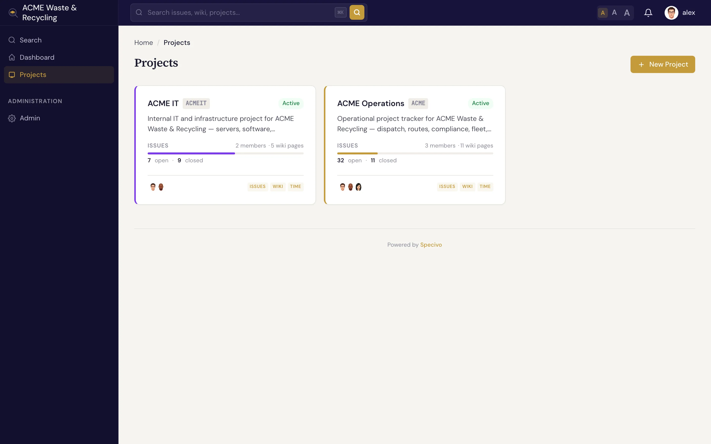
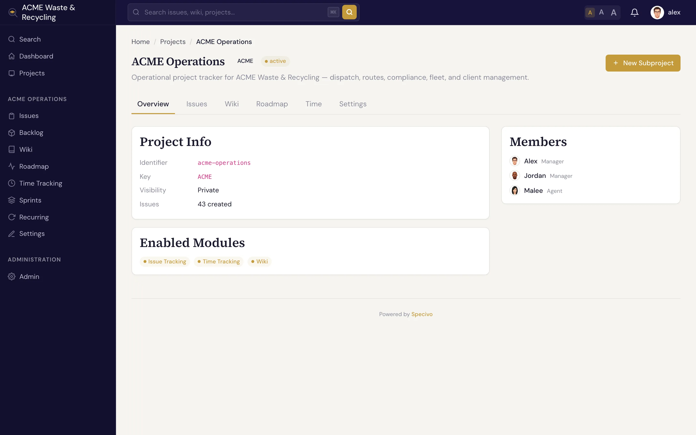

# 项目 {#projects}

**项目** 是承载一组工作的容器：工作项（Issue）、[维基](../wiki/index.md)（Wiki）、[版本](versions.md)、[冲刺](sprints.md)（Sprint），以及带角色的成员列表都放在项目里。每个工作项、维基页面和工时记录都恰好属于一个项目。你在 Specivo 里做的大部分事情，都发生在某个项目之内。

## 项目由哪些要素构成 {#what-defines-a-project}

| 字段 | 内容 |
|---|---|
| **名称** | 人类可读的标题，显示在列表和页头中 |
| **标识** | 一个简短的**大写**前缀，例如 `ACME`，每个工作项编号都以它开头（`ACME-1`、`ACME-42`）。管理员可以重命名；见 [重命名项目标识](#renaming-a-project-key)。 |
| **标识符** | 用于链接的 URL slug，例如 `/projects/acme/` |
| **父项目** | 可选的父项目，用来把相关项目归到同一个上级之下 |
| **可见性** | **公开**（任何能访问站点的人都可以阅读）或 **私有**（仅成员可见） |
| **颜色** | 在列表和徽标中为项目着色，便于一眼认出 |

**项目标识** 是你输入和粘贴最多的部分。一旦大家知道 `ACME-42` 是 ACME 项目里的一个工作项，这个引用在哪里都好用：聊天、提交信息、[搜索](../issues/finding.md) 都行。

### 重命名项目标识 {#renaming-a-project-key}

管理员可以通过 REST API 重命名项目标识，例如把 `OLD` 改成 `ACME`：向 `POST /api/v1/admin/projects/OLD/rename/` 发送 `{"new_key": "ACME"}`。项目中的每个工作项都会换上新编号，`OLD-12` 变成 `ACME-12`。旧引用依然有效，并会指向新编号下的同一个工作项：指向 `/issue/OLD-12/` 的链接、描述和评论里写的 `OLD-12`、提交信息里的 `OLD-12` 都是如此。旧标识会继续为该项目保留，其他项目不能再使用它。

## 成员角色 {#member-roles}

人加入项目时会带有一个 **角色**，角色决定他能做什么。Specivo 内置四种：

| 角色 | 适用对象 | 能做什么 |
|---|---|---|
| **Manager**（管理者） | 项目负责人 | 完全控制：设置、成员、版本、冲刺、工作流，以及所有工作项和维基操作 |
| **Developer**（开发者） | 实际干活的人 | 创建和更新工作项、记录工时、编辑维基页面、评论 |
| **Reporter**（报告人） | 干系人和需求提出者 | 提交工作项并评论、跟进进度 |
| **Agent**（代理） | 自动化及 API/[MCP](../ai-agents/index.md) 账户 | 专为通过 API 操作的服务账户设计的角色 |

**Agent** 角色是为 AI 助手和自动化准备的。团队通常会创建一个专用的服务账户，在需要它操作的项目上授予 Agent 角色，并为它签发 API 密钥。见 [AI 智能体与 MCP](../ai-agents/index.md)。

还有第五种角色 **Automation**（自动化），添加成员时不会出现在选项里：当项目为已连接的代码仓库开启 [合并自动化](../integrations/repositories.md#merge-automation) 时，内置的 **Git** 账户默认获得这个角色（管理者也可以改选其他角色）。

### 添加成员 {#adding-members}

打开 **设置 → 成员**，选择角色，在 **添加成员** 字段中输入名字并从建议中选中用户或用户组，再点击 **添加**。成员必须是已存在的用户或用户组，所以只输入了名字却没有从列表中选中的，不会被添加，表单会提示你。没有匹配项时，列表也会说明。管理员还会看到 **创建用户“…”** 选项，它会打开新建用户表单并预填输入的名字；新账户创建后会自动被选中，只需再选角色并点击 **添加**。拥有 **Manager** 角色但不是管理员的人，则会被提示请管理员来创建账户。

!!! note "角色按项目设定"
    同一个人可以在一个项目里是 Manager，在另一个项目里是 Reporter。成员身份和角色在每个项目上单独设置，不是全局的。

### 角色能看到什么 {#what-a-role-can-see}

除权限之外，每个角色还有三项可见性设置，由管理员在 **管理 → 角色** 中编辑：

| 设置 | 取值 | 默认 |
|---|---|---|
| **用户可见性** | **所有活跃用户**，或 **可见项目的成员**：本人加上他能打开的项目中的所有成员（直接成员或通过用户组加入的成员） | 所有活跃用户 |
| **工时记录可见性** | 项目中的 **所有工时记录**，或 **仅自己的工时记录** | 所有工时记录 |
| **AI 使用可见范围** | 项目中的 **全部 AI 使用**，或 **自己的 AI 使用** | 自己的 AI 使用（内置 Manager 角色：全部 AI 使用） |

*用户可见性* 限制成员在用户选择器（例如添加项目成员或输入名字时）和工作项关注者列表中能找到的人。*工时记录可见性* 限制项目的工时区域、工作项的工时标签页及其累计工时、版本的累计工时、计费工时报表，以及仪表盘上的智能体动态。计费项目上的外包人员通常会这样限制工时：他们只记录并查看自己的工时，看不到别人的。

工时记录可见性只对拥有 **查看工时记录** 权限的角色有意义；如果某人在项目中的角色都没有这项权限，他在那里看不到任何工时，连自己的也看不到。

*AI 使用可见范围* 对 AI 使用记录（大家的 AI 编码工具消耗的 token 和费用）同样适用，并且只对拥有 **查看 AI 使用** 权限的角色有意义，但有一点不同：无论角色如何，每个人始终能看到以自己名义记录的 AI 使用，以及是哪个账户记录的。设为 **全部 AI 使用** 的角色会显示项目中每个人的使用量和费用，所以只授予应该看到这些信息的人，例如项目负责人；默认设置只让人看到自己的使用情况。某人看不到的工作项上的记录，对他也保持隐藏，除非那些记录是他自己的。

AI 使用相关的权限有 **查看 AI 使用**、**记录 AI 使用**（在项目中记录自己的使用）、**编辑/排除任意 AI 使用记录**，以及 **代其他成员记录 AI 使用**。最后一项是共享服务账户为其代报的人记录使用量时所需的，这些人必须是项目的活跃成员。不属于任何项目的使用量，任何人都可以为自己记录，管理员可以为他人记录。把别人的记录移到另一个项目，需要在目标项目中同样拥有代记录权限。内置角色的权限：Manager 四项全有，Developer 和 Agent 可查看和记录，Reporter 可查看。

当某人持有多个角色时，取 **最宽** 的设置，与 Redmine 一致：只要在某个项目上有一个角色同时拥有 *查看工时记录* 和 *所有工时记录*，就能看到该项目的所有工时记录，其他角色怎么设都不影响。
用户可见性方面，只要他在任意项目的任意角色中有一个设为 *所有活跃用户* 即可；没有任何项目角色的人遵循内置的 **Non member**（非成员）角色。管理员始终能看到一切。

### 相似工作项推荐 {#similar-issue-suggestions}

项目设置的 **常规** 标签页有一个 **在新建工作项表单中推荐相似工作项** 复选框，默认勾选。有人输入新工作项的主题时，表单会列出项目中主题相似的工作项（见 [相似工作项](../issues/creating.md#similar-issues)）。取消勾选即可为该项目关闭这个列表。如果管理员已为整个实例关闭推荐，这个复选框不起作用，并会有相应说明。

### 报表货币 {#reporting-currency}

项目的金额报表（例如 AI 支出）按实例的报表货币显示。要让该项目使用另一种货币，打开项目设置的 **常规** 标签页，在 **报表货币** 下选择货币，点击 **保存**。选择 **实例默认** 则重新跟随实例设置。只能选择管理员已启用的货币；见 [货币与报表货币](../install/currencies.md)。修改需要 *管理项目* 权限，并会记入审计日志。

### 公开项目与搜索引擎 {#public-projects-and-search-engines}

管理员为公开项目开启匿名访问后，只要实例的匿名访问开关打开，无需账户即可阅读该项目。访客还可以在项目中搜索，使用的混合搜索与其他人相同，但按地址有速率限制（见 [搜索速率限制](../install/configuration.md#search-rate-limits)）。项目页面、工作项列表、工作项和维基页面也可能出现在搜索引擎中，但前提是管理员在 **管理 → 设置 → 匿名访问** 下打开了 **允许搜索引擎索引公开页面**（默认关闭）。私有工作项和评论，以及未开启匿名访问的项目的所有页面，都绝不会被索引。`robots.txt` 和 `/sitemap.xml` 中列出哪些内容、如何把某个公开项目排除在外，见 [搜索引擎](../install/configuration.md#search-engines)。

## 项目状态 {#project-status}

项目处于以下三种状态之一：

- **活跃**：正常状态，项目可以开展工作。
- **已关闭**：工作已收尾。项目仍可完整阅读，但被标记为不再活跃，因此从日常视图中退出。
- **已归档**：留作存档。项目被保留，但收起来不再显眼。

## 项目概览 {#the-project-overview}

**概览** 是项目的主页。它汇集了项目名称、描述，以及通往工作项、[路线图](versions.md)、[冲刺](sprints.md)、[维基](../wiki/index.md) 和工时的快捷链接，让你一眼看清项目全貌，并直接跳到需要的区域。

从这里你通常会进入：

- [版本与路线图](versions.md)：把工作项按发布版本分组，跟踪进度。
- [冲刺](sprints.md)：规划并执行有时限的迭代。
- [重复任务](recurring-tasks.md)：按计划自动生成工作项的重复模板。
- [工时记录](time-tracking.md)：记录工时并查看报表。
