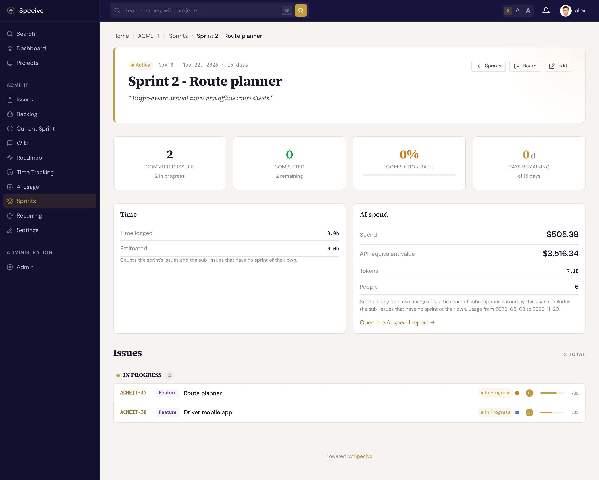
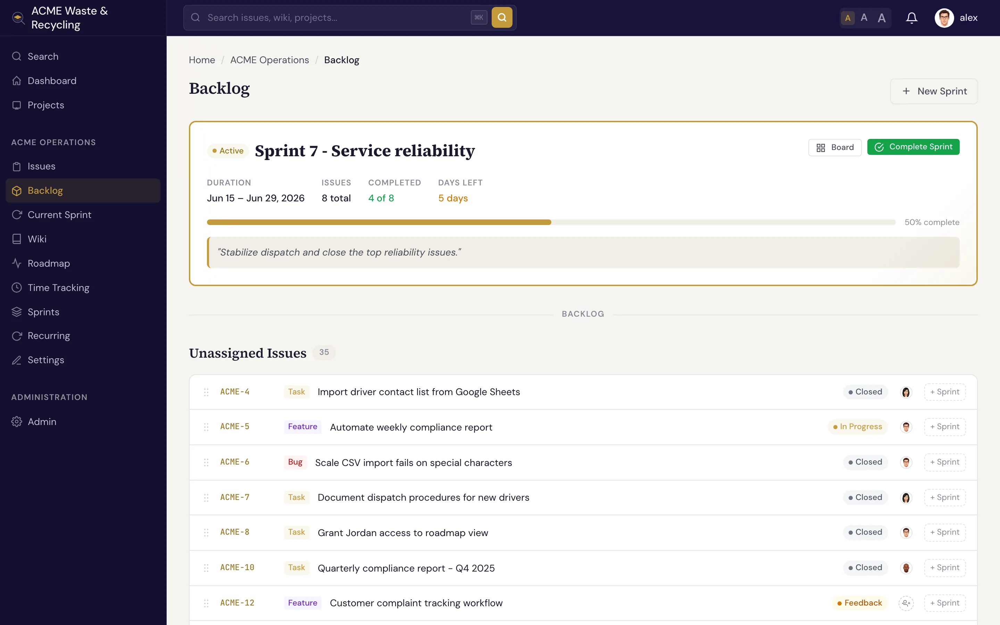
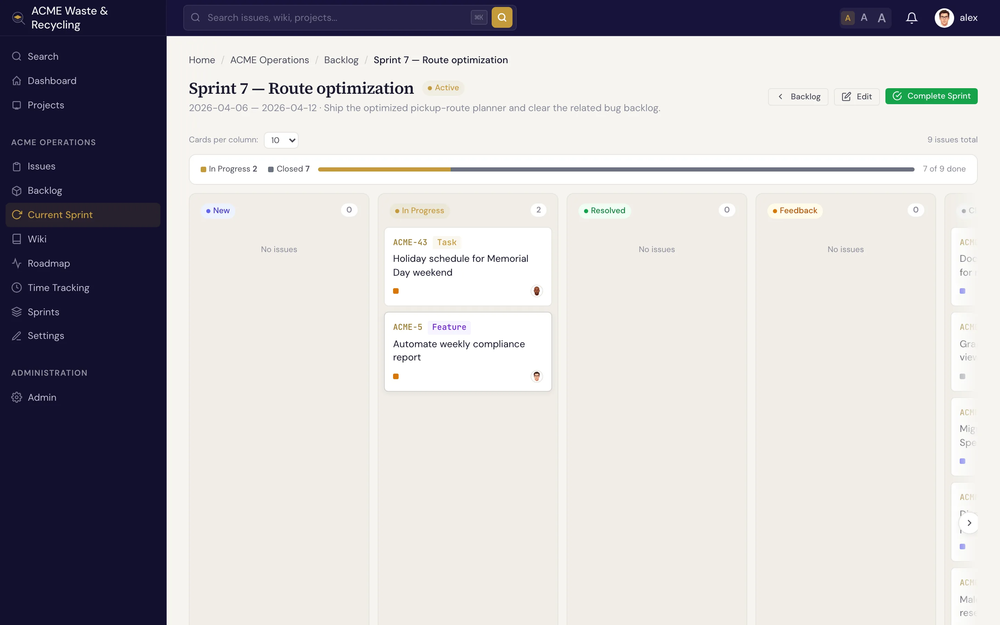

# 冲刺 {#sprints}

**冲刺**（Sprint）是有固定时间窗口的迭代：团队在这段时间内承诺完成一组工作项（Issue）并达成一个目标。[版本](versions.md)面向发布做计划，冲刺则安排接下来一两周的工作。冲刺要先 **计划**，再 **开始**，最后 **完成**。

## 冲刺包含的内容 {#what-a-sprint-holds}

| 字段 | 内容 |
|---|---|
| **名称** | 冲刺的名称，例如“Sprint 14” |
| **目标** | 用一句话说明这个冲刺要达成什么 |
| **状态** | **已计划**、**活跃** 或 **已完成** |
| **开始日期 / 结束日期** | 冲刺的起止时间 |

!!! note "每个项目只能有一个活跃冲刺"
    一个项目同一时间只能有 **一个活跃冲刺**。可以提前计划任意多个冲刺，但只能一个接一个地开始。

## 冲刺的生命周期 {#the-sprint-lifecycle}

1. **计划**。创建冲刺，设置目标和日期，并在状态为 **已计划** 时从待办列表把工作项拉进来。
2. **开始**。到了开始日期，**开始** 这个冲刺。它成为项目中唯一的 **活跃** 冲刺，其中的工作项会显示在冲刺看板上。
3. **完成**。时间窗口结束时，**完成** 这个冲刺。完成时会 **为团队速率生成快照**，记录这个冲刺完成了多少工作，作为计划下一个冲刺的基准。未完成的工作项会移回待办列表；如果你选择了同一项目中另一个 **已计划** 或 **活跃** 的冲刺，则移到那个冲刺。

### 已完成的冲刺不再接受新工作项 {#a-completed-sprint-is-closed-to-new-issues}

冲刺完成后，就不能再往里添加工作项：冲刺选择器不再列出它，REST API 和 MCP 也会拒绝。已经在这个冲刺里的工作项仍然显示它，你也仍然可以把工作项移出去（清空冲刺字段，或移到一个未完成的冲刺）。这不会改变冲刺的速率，因为速率在冲刺完成时就已记录。

### 工作项历史中的生命周期 {#the-lifecycle-in-issue-history}

开始和完成冲刺都会记录在每个受影响工作项的 **动态** 选项卡中，并记在操作者名下：冲刺中的每个工作项都会显示“冲刺 «名称» 已开始”，留在冲刺中的工作项显示“冲刺 «名称» 已完成”，被移出的工作项则显示一条普通的冲刺变更记录。这些记录不会触发通知。

### 怎样才算完成 {#what-counts-as-done}

Specivo 根据状态的 **类别**（已完成或已关闭）判断工作项是否完成，从不看状态的名称。冲刺列表、看板的进度行、燃尽图、分析页面和速率快照都使用同一条规则。即使你的团队把 **Resolved**（已解决）改名为 **Shipped**，结果也不会变；而一个属于进行中类别的状态，即使碰巧叫“Resolved”，也不算完成。

### 速率与私有工作项 {#velocity-and-private-issues}

已完成冲刺的速率，以及冲刺页面上的各项计数，只统计 **你** 有权查看的工作项。因此，如果冲刺中有些工作项是[私有](../issues/creating.md#private-by-default)的，或因角色限制而不可见，两个人查看同一个已完成的冲刺时可能会看到不同的数字。REST API 和 MCP 只返回计数，从不返回这些工作项的 ID。

## 工时与 AI 支出 {#time-and-ai-spend}

冲刺页面会显示 **已记录工时** 和 **预计** 工时，旁边是 **AI 支出** 卡片。这三项统计的都是冲刺中的工作项，以及没有单独设置冲刺的子工作项。子工作项计入离它最近且设置了冲刺的父工作项所在的冲刺。只有你有权查看的工作项和记录才会计入；已记录工时也只在你有权查看项目的工时记录时才显示。

**AI 支出** 卡片显示这个冲刺的支出、API 等价价值、token 数和人数。点击 **打开 AI 支出报告**，会打开项目的[支出报告](ai-spend-reports.md#release-and-sprint)，并且只显示这个冲刺的数据。

## 待办列表 {#the-backlog}

**待办列表** 存放尚未排入任何冲刺的工作项。计划就在这里做：查看有哪些工作项在等待，决定哪些适合放进下一个迭代，再把它们分配到冲刺。工作项的 **冲刺** 字段就是两者之间的纽带：在待办列表或工作项页面设置这个字段，就能把工作项拉进冲刺。

## 冲刺看板 {#the-sprint-board}

**冲刺看板** 把活跃冲刺中的工作项显示为卡片，按状态分列，例如 **New**（新建）、**In Progress**（进行中）、**Resolved** 等。团队可以由此了解迭代的进展，并推动工作向前。各列遵循状态类别（待办、活跃、已完成），与[工作项看板](../issues/index.md)使用的类别相同。

冲刺期间用看板处理日常流转；需要跨多个发布的长期视图时，使用[路线图](versions.md)。
