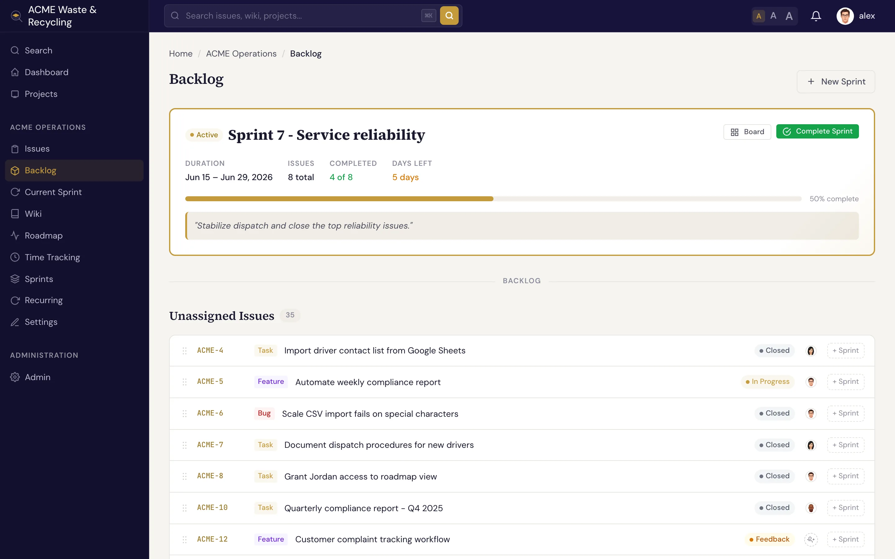
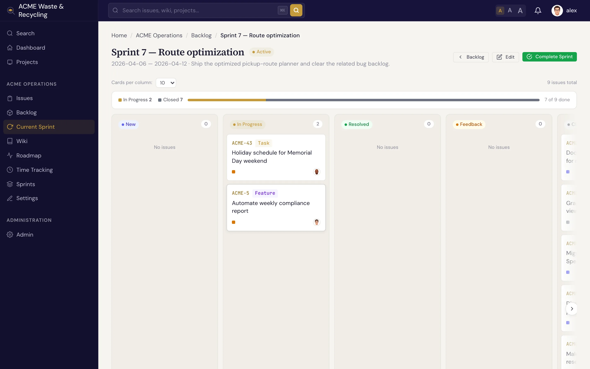

# 冲刺 {#sprints}

**冲刺**（Sprint）是固定时长的迭代：在一个固定的时间窗口内，团队承诺完成一组工作项（Issue）和一个目标。[版本](versions.md)面向发布做规划，冲刺则规划接下来一两周的工作。冲刺的流程是：**计划**、**开始**、**完成**。

## 冲刺包含什么 {#what-a-sprint-holds}

| 字段 | 内容 |
|---|---|
| **名称** | 冲刺的名称，例如“Sprint 14” |
| **目标** | 一句话说明这个冲刺要达成什么 |
| **状态** | **已计划**、**活跃** 或 **已完成** |
| **开始日期 / 结束日期** | 冲刺运行的时间窗口 |

!!! note "每个项目只能有一个活跃冲刺"
    一个项目同一时间只能有 **一个活跃冲刺**。你可以提前计划任意多个冲刺，但只能依次开始。

## 冲刺的生命周期 {#the-sprint-lifecycle}

1. **计划。** 创建冲刺，设置目标和日期，并在状态为 **已计划** 时从待办列表把工作项拉进来。
2. **开始。** 时间窗口到来时，**开始** 冲刺。它成为项目唯一的 **活跃** 冲刺，其中的工作项会显示在冲刺看板上。
3. **完成。** 时间窗口结束时，**完成** 冲刺。完成时会 **记录团队速率快照**（即完成了多少工作），作为计划下一个冲刺的基线。未完成的工作项移回待办列表；如果你指定了同一项目中另一个 **已计划** 或 **活跃** 的冲刺，则移入该冲刺。

### 已完成的冲刺不再接受新工作项 {#a-completed-sprint-is-closed-to-new-issues}

冲刺完成后，就不能再向其中添加工作项：冲刺选择器不再列出它，REST API 和 MCP 也会拒绝。已经在该冲刺中的工作项仍会显示这个冲刺，你也仍可以把工作项移出（清空其冲刺字段，或移到一个未完成的冲刺）。这不会改变冲刺的速率，速率在冲刺完成时就已记录。

### 生命周期在工作项历史中的记录 {#the-lifecycle-in-issue-history}

开始和完成冲刺会显示在每个受影响工作项的 **动态** 标签页中，记在执行操作者名下：冲刺中的每个工作项都会出现“Sprint «名称» started”，留在冲刺中的工作项会出现“Sprint «名称» completed”，被移出的工作项则显示一条普通的冲刺字段变更。这些记录不会发送通知。

### 怎样算完成 {#what-counts-as-done}

Specivo 根据工作项状态所属的 **类别**（done 或 closed）判断它是否完成，从不看状态的名称。冲刺列表、看板的进度条、燃尽图、分析页面和速率快照都遵循同一规则。如果团队把 **Resolved**（已解决）改名为 **Shipped**，一切照旧；而一个碰巧叫“Resolved”的进行中状态也不会被算作完成。

### 速率与私有工作项 {#velocity-and-private-issues}

已完成冲刺的速率以及冲刺页面上的各项计数，只涵盖 **你** 有权查看的工作项。因此，当冲刺中有些工作项是[私有的](../issues/creating.md#private-by-default)，或因角色限制而不可见时，两个人查看同一个已完成的冲刺可能看到不同的数字。REST API 和 MCP 只返回计数，绝不返回背后工作项的 id。

## 待办列表 {#the-backlog}

**待办列表**是尚未纳入任何冲刺的工作项池。计划工作就在这里进行：查看待处理的内容，决定哪些适合放进下一个迭代，然后把工作项指派到某个冲刺。工作项的 **冲刺** 字段就是这个关联，在待办列表或工作项页面中设置它，即可把工作项拉入冲刺。

## 冲刺看板 {#the-sprint-board}

**冲刺看板**把活跃冲刺中的工作项按状态分列显示为卡片（New、In Progress、Resolved 等），团队可以一目了然地看到迭代的进展并推进工作。看板的列遵循状态类别（待办、活跃、完成），与驱动[工作项看板](../issues/index.md)的类别相同。

冲刺期间用看板跟进日常工作流；需要跨发布的长期视图时，使用[路线图](versions.md)。
