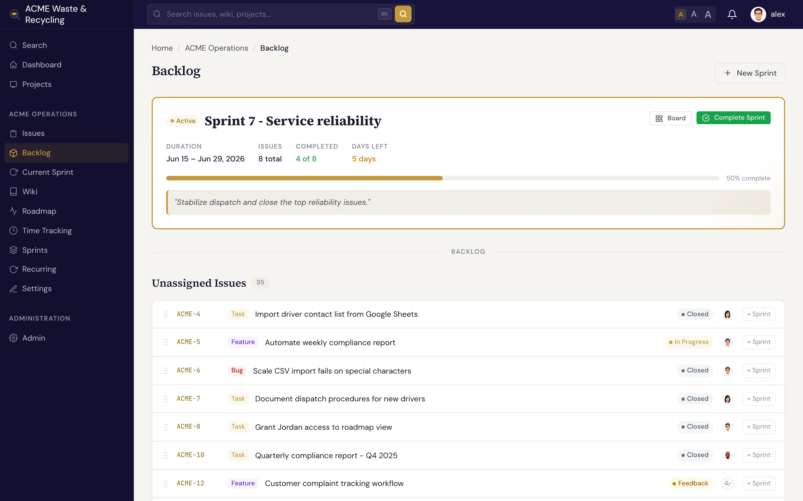
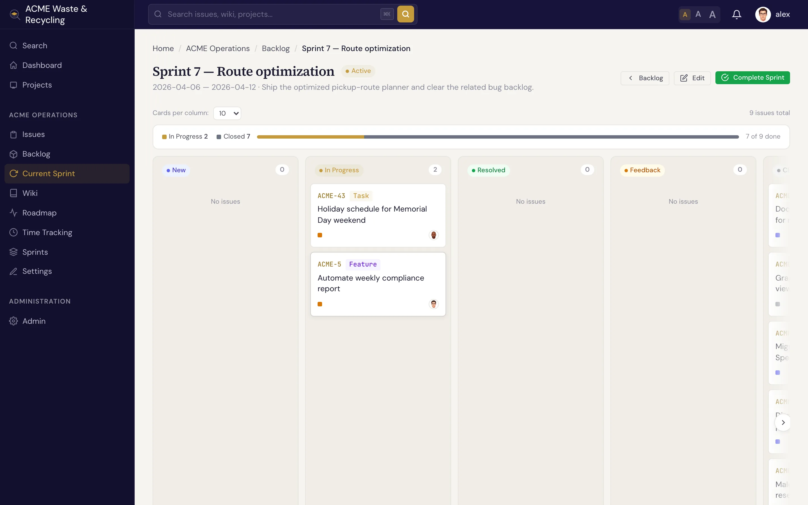

# 冲刺 {#sprints}

**冲刺**（Sprint）是限时迭代：在一段固定的时间窗口内，团队承诺完成一组工作项（Issue）并达成一个目标。[版本](versions.md)面向发布做规划，冲刺则规划接下来一到两周的工作。一个冲刺要经历 **计划**、**开始** 和 **完成** 三个阶段。

## 冲刺包含什么 {#what-a-sprint-holds}

| 字段 | 内容 |
|---|---|
| **名称** | 冲刺的标签，例如“Sprint 14” |
| **目标** | 一句话说明这个冲刺要达成什么 |
| **状态** | **已计划**、**活跃** 或 **已完成** |
| **开始日期 / 结束日期** | 冲刺持续的时间窗口 |

!!! note "每个项目只能有一个活跃冲刺"
    一个项目同一时间只能有 **一个活跃冲刺**。你可以提前计划任意多个冲刺，但只能一个接一个地开始。

## 冲刺的生命周期 {#the-sprint-lifecycle}

1. **计划**。创建冲刺，设置目标和日期，并在状态为 **已计划** 时从待办列表把工作项拉进来。
2. **开始**。时间窗口到来时，**开始** 冲刺。它成为项目唯一的 **活跃** 冲刺，其中的工作项会显示在冲刺看板上。
3. **完成**。窗口结束时，**完成** 冲刺。完成时 Specivo 会 **记录团队速率的快照**，即这个冲刺实际完成了多少工作，作为规划下一个冲刺的基线。

### 怎样算完成 {#what-counts-as-done}

Specivo 根据状态所属的 **类别**（完成或已关闭）判断工作项是否完成，而不看状态名称。冲刺列表、看板的进度条、燃尽图、分析页面和速率快照都遵循同一规则。即使团队把 **Resolved**（已解决）改名为 **Shipped**，结果也不会变；反过来，一个进行中的状态哪怕恰好叫“Resolved”，也不会被算作完成。

### 速率与私有工作项 {#velocity-and-private-issues}

已完成冲刺的速率以及冲刺页面上的各项计数，只统计 **你** 有权查看的工作项。因此，当冲刺中有部分工作项是[私有的](../issues/creating.md#private-by-default)或因角色权限而隐藏时，两个人查看同一个已完成冲刺可能会看到不同的数字。REST API 和 MCP 只返回计数，不会返回背后工作项的 id。

## 待办列表 {#the-backlog}

**待办列表** 是尚未分配到任何冲刺的工作项的集合。规划就在这里进行：查看待处理的工作项，决定哪些适合下一个迭代，然后把它们分配到冲刺。工作项的 **冲刺** 字段就是这条纽带：在待办列表或工作项本身设置这个字段，即可把工作项拉进冲刺。

## 冲刺看板 {#the-sprint-board}

**冲刺看板** 把活跃冲刺中的工作项以卡片形式按状态分列显示，例如 **New**（新建）、**In Progress**（进行中）、**Resolved** 等，让团队一眼看到迭代的进展并推进工作。列的划分遵循状态类别（待办、活跃、完成），与[工作项看板](../issues/index.md)使用的类别相同。

冲刺期间用看板管理日常流转；需要跨发布的更长视角时，用[路线图](versions.md)。
