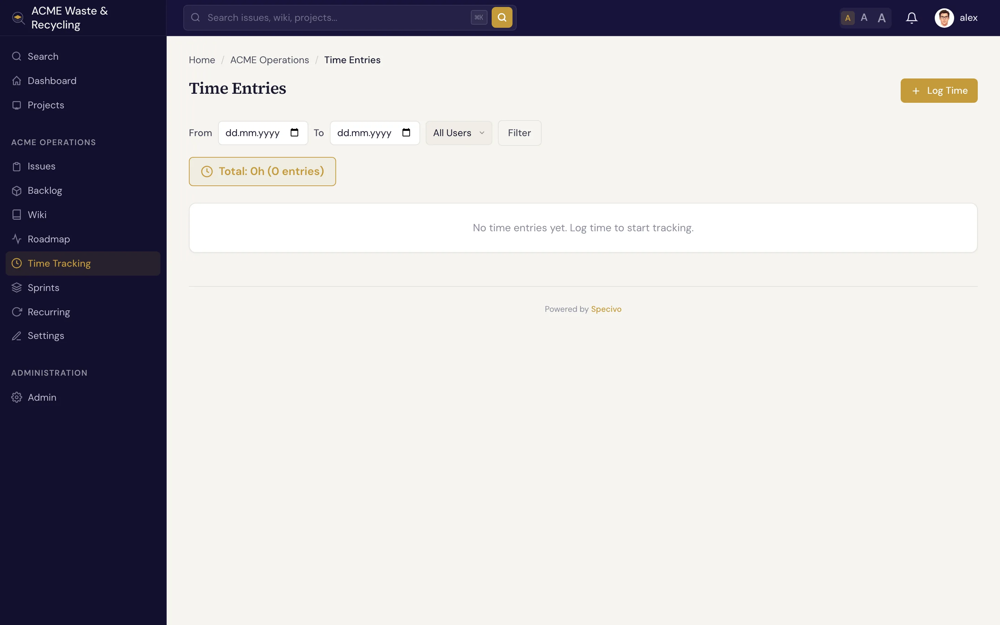

# 工时记录 {#time-tracking}

在 Specivo 中，你可以为所做的工作 **记录工时**：把花在某个工作项（Issue）或项目上的小时数记下来，并标注活动类型。记录的工时会汇总到报表中，让你看清精力花在了哪里，并与预估进行对比。

## 谁能做什么 {#who-can-do-what}

项目中的工时记录由三项角色权限控制：

| 权限 | 允许 |
|---|---|
| **查看工时记录** | 查看工时：项目的 **时间** 区域、工作项的时间标签页和已记录总工时、版本的已记录总工时，以及计费工时报表。没有这项权限就看不到任何工时记录，自己的也不例外。 |
| **记录工时** | 手动或用计时器记录工时，以及编辑或删除自己的记录（前提是你能看到它们）。 |
| **编辑/删除任何工时记录** | 编辑或删除项目中任何人的记录。 |

默认情况下，**Manager**（管理者）拥有全部三项权限，**Developer**（开发者）和 **Agent**（代理）可以查看和记录工时，**Reporter**（报告者）和内置的 **Non member**（非成员）角色则一项都没有。即使没有 *编辑/删除任何工时记录* 权限，只要你在项目中拥有 *记录工时* 权限，仍然可以编辑或删除自己的记录。管理员可以执行所有操作。你无权使用的按钮（*记录工时*、工作项上的记录工时表单、编辑控件）会被隐藏。

计费工时报表使用的项目 **计费费率** 通过 REST API 管理。创建、修改或删除费率需要 **管理项目设置** 权限，列出费率需要 **查看工时记录** 权限。没有单独的计费权限。

## 在工作项上记录工时 {#log-time-against-an-issue}

打开工作项，添加一条工时记录：填写 **小时数**、**日期**、**活动**，还可以附上备注。在工作项上记录工时是最常见的做法，因为它把投入和具体的工作绑在一起。对于无法对应到某一个工作项的工作，也可以在项目层面记录工时。

### 活动 {#activities}

每条记录都标注一种 **活动**，报表就能按类型拆分投入：

| 活动 | 用途 |
|---|---|
| **Development**（开发） | 编写和修改代码，默认选项 |
| **Design**（设计） | UI、UX 和设计工作 |
| **Testing**（测试） | QA、编写测试、验证 |
| **Meetings**（会议） | 计划、站会、评审 |
| **Support**（支持） | 帮助用户、响应请求 |

默认选中 **Development**，常见场景可以少点一次。

## 用计时器计时 {#time-it-with-a-timer}

不必自己累加小时数，让计时器来数。打开工作项，在编号旁选择 **启动计时器**（需要项目中的 *记录工时* 权限）。同一时间只能有一个计时器：

- 计时器运行期间，每个页面的页眉都会显示该工作项编号和已用时长，工作项页面则显示 *计时器运行中*。点击页眉中的计时器可查看该工作项及其标题。
- **停止并记录** 会询问 **活动**（默认活动已预选）和可选备注，然后在该工作项上写入一条当天的工时记录。已用时长四舍五入到百分之一小时；忘记停止的计时器会被封顶（默认 12 小时，除非管理员改过），并在备注中注明。
- **放弃** 直接丢弃计时器，不写入任何内容。

如果选择 **启动计时器** 时另一个工作项上已有计时器在运行，Specivo 会先询问：**记录并启动** 用默认活动写入其工时，**放弃并启动** 则直接丢弃，之后再启动新计时器。要给旧计时器选择其他活动或添加备注，请先在页眉中停止它。

停止计时器或启动另一个计时器时，会再次检查正在运行的计时器：如果这期间你失去了在其项目或工作项上记录工时的权限，计时器会被丢弃，不写入任何工时。使用 **记录并启动** 后，工作项页面会短暂显示一条提示，说明旧计时器的去向：在哪个工作项上记录了多少小时，或者已被丢弃。如果你已看不到那个工作项，页眉仍显示其编号，但不显示标题。

AI 智能体（AI agent）可以通过 `specivo_timer` 工具操作同一个计时器（见
[智能体能做什么](../ai-agents/capabilities.md)）。

## 通过提交记录工时 {#log-time-from-a-commit}

如果项目配置了[代码仓库集成](../integrations/repositories.md)，并开启了提交命令和工时记录，提交信息也可以记录工时：`ACME-12 @1h30m`（也可写成 `@2h`、`@90m` 或 `@1.5h`）会以默认活动为提交作者在 ACME-12 上记录该时长，日期为提交当天。作者是指用已验证邮箱写下这次提交的 Specivo 账户，并且需要项目中的 *记录工时* 权限。时长紧跟在工作项编号之后，写在同一行；零会被忽略，同一次提交中单个工作项超过 24 小时的会截断为 24 小时。参见
[提交命令](../integrations/repositories.md#commit-commands)。

## 预估与已用工时 {#estimate-versus-spent}

工作项带有 **预估**（预计工时，包括原始预估和剩余预估），以及实际 **已记录** 的工时。两者对比就能看出工作是否在正轨上：一个预估 8 小时、已记录 12 小时却仍未关闭的工作项，值得看一眼。完整字段见[什么是工作项？](../issues/index.md)。

这三个值都由任何可以编辑该工作项的人在工作项侧边栏或编辑表单中手动设置，以小时和分钟为单位。**原始预估** 保留最初的计划，而预估可随时调整；**剩余预估** 是剩余的工作量，记录工时不会减少它。工作项的 **时间** 标签页会在这三者旁边汇总已记录的小时数。

## 项目的时间区域 {#the-project-time-area}

每个项目都有一个 **时间** 区域，列出工时记录并汇总成报表：按活动、按人员以及按日期范围统计，让 [Manager](index.md) 看清投入在项目中的分布。

!!! note "谁能看到谁的工时"
    默认情况下，拥有 **查看工时记录** 权限的人都能看到所有记录。角色若设为 **仅自己的工时记录**（见[角色能看到什么](index.md#what-a-role-can-see)），其持有者只能看到自己记录的工时：在时间区域、工作项、版本汇总和报表中都是如此。拥有多个角色的人按其中范围最宽的设置处理。

    记录在你看不到的工作项上的工时（例如他人的私有工作项）在所有地方都会排除：列表、各项汇总以及计费工时报表，因此数字不会泄露隐藏工作项上的工作。直接记录在项目上、不关联工作项的工时不受影响。你自己的记录始终对你可见，哪怕那个工作项你已经看不到了。

