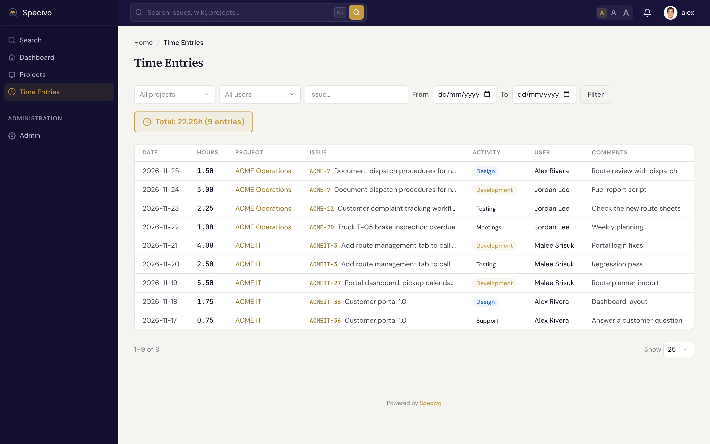
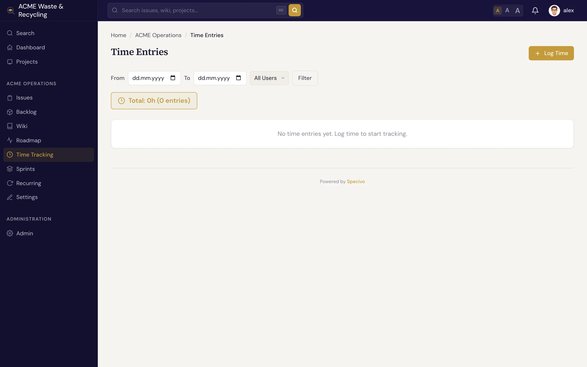

# 工时记录 {#time-tracking}

在 Specivo 中，你可以为手头的工作 **记录工时**：在某个工作项（Issue）或项目上花了多少小时，属于哪类活动。已记录的工时会汇总到报表中，方便你了解投入都花在了哪里，并与预估对比。

## 谁能做什么 {#who-can-do-what}

项目中的工时记录由 3 个角色权限控制：

| 权限 | 允许的操作 |
|---|---|
| **查看工时记录** | 查看工时：项目的时间区域、工作项的时间标签页和已记录工时合计、版本的已记录工时合计，以及计费工时报表。没有此权限就看不到任何工时记录，包括自己的。 |
| **记录工时** | 手动或用计时器记录工时，并编辑或删除自己的工时记录（前提是你能看到它们）。 |
| **编辑任何工时记录** | 编辑或删除项目中任何人的工时记录。 |

默认情况下，**Manager**（管理者）拥有全部 3 个权限，**Developer**（开发者）和 **Agent**（智能体）可以查看和记录工时，**Reporter**（报告者）和内置的 **Non member**（非成员）角色则一个都没有。没有 *编辑任何工时记录* 权限时，只要在项目中拥有 *记录工时* 权限，你仍然可以编辑或删除自己的工时记录。管理员可以执行所有操作。你无权使用的按钮和控件（*记录工时*、工作项上的记录工时表单、编辑控件）会被隐藏。

计费工时报表使用的项目 **计费费率** 通过 REST API 管理。创建、修改或删除费率需要 **管理项目设置** 权限，列出费率需要 **查看工时记录** 权限。没有单独的计费权限。

## 在工作项上记录工时 {#log-time-against-an-issue}

打开工作项，添加一条工时记录：填写 **小时** 数、**日期**、**活动**，还可以加一条评论。在工作项上记录工时是最常见的做法，因为这样能把投入对应到具体的一项工作。如果某些工作不对应单个工作项，也可以在项目级别记录工时。

### 活动 {#activities}

每条工时记录都带有一个 **活动**，报表据此按类型拆分投入：

| 活动 | 适用于 |
|---|---|
| **开发** | 编写和修改代码（默认值） |
| **设计** | UI、UX 和设计工作 |
| **测试** | QA、编写测试、验证 |
| **会议** | 规划、站会、评审 |
| **支持** | 帮助用户、答复请求 |

默认选中 **开发**，所以最常见的情况可以少点一次。

## 用计时器计时 {#time-it-with-a-timer}

不想自己累加小时数，可以让计时器来计。打开工作项，点击工作项编号旁边的 **启动计时器**（需要在项目中拥有 *记录工时* 权限）。同一时间只能有一个计时器：

- 计时器运行期间，每个页面的页头都会显示工作项编号和已用时间，工作项页面上会显示 *计时器运行中*。点击页头中的计时器，可以查看对应的工作项及其主题。
- **停止并记录** 会让你选择 **活动**（已预先选中默认活动）并填写可选的评论，然后在该工作项上写入一条日期为今天的工时记录。已用时间四舍五入到 0.01 小时。一直没停的计时器会按上限封顶（默认 12 小时，除非管理员改过），并在评论中注明。
- **放弃** 会丢弃计时器，不写入任何内容。

点击 **启动计时器** 时，如果另一个工作项上已有计时器在运行，Specivo 会先询问：**记录并启动** 会用默认活动把旧计时器的时间写入工时记录，**放弃并启动** 则直接丢弃，随后新计时器开始计时。如果想用其他活动或带评论记录旧计时器的时间，请先在页头中停止它。

停止计时器或启动另一个计时器时，Specivo 会重新检查正在运行的计时器：如果在此期间你已失去在其项目或工作项上记录工时的权限，计时器会被丢弃，不写入任何工时。选择 **记录并启动** 后，工作项页面上会出现一条简短提示，说明旧计时器的处理结果：在哪个工作项上记录了多少小时，或者它已被丢弃。如果你已经看不到那个工作项，页头仍会显示它的编号，但不显示主题。

AI 智能体（AI agent）可以通过 `specivo_timer` 工具操作同一个计时器（参见[智能体能做什么](../ai-agents/capabilities.md)）。

## 通过提交记录工时 {#log-time-from-a-commit}

如果项目配置了[代码仓库集成](../integrations/repositories.md)，并且开启了提交命令和工时记录，提交信息也能记录工时：`ACME-12 @1h30m`（也可以写 `@2h`、`@90m` 或 `@1.5h`）会为提交作者在 ACME-12 上记录这段工时，使用默认活动，日期为提交当天。提交作者是指已验证邮箱与提交邮箱一致的 Specivo 账户，并且需要在项目中拥有 *记录工时* 权限。时间要紧跟在工作项编号之后，写在同一行；值为 0 时会被忽略，单次提交中为同一个工作项记录的时间超过 24 小时会被截为 24 小时。
详见[提交命令](../integrations/repositories.md#commit-commands)。

## 预估与已用工时 {#estimate-versus-spent}

工作项上有 **预计工时**（以小时计，另有原始预估和剩余预估），也有实际 **已记录** 的工时。对比两者，就能判断一项工作是否按计划推进：一个工作项预计 8 小时，已记录 12 小时却还没关闭，就值得留意。完整的字段说明见[什么是工作项？](../issues/index.md)。

这 3 个值都由人工填写，以小时和分钟为单位，可以在工作项侧边栏或编辑表单中设置，有权编辑该工作项的人都能修改。预计工时调整时，**原始预估** 保留最初的计划值；**剩余预估** 是还剩多少工作，记录工时不会让它自动减少。工作项的 **时间** 标签页会在这 3 个值旁边显示已记录工时的合计。

## 工时条目页面 {#the-time-entries-page}

侧边栏中的 **工时条目** 会列出你有权查看工时记录的所有项目中的工时记录，最新的排在最前，并带有 **项目** 列。可以用 **项目**、**用户** 和 **工作项** 筛选器缩小范围：每个筛选器都是一个搜索框，只提供你能看到的项目、人员和工作项。项目自己的 **时间** 区域也有同样的 **用户** 和 **工作项** 筛选器，还有一个 **所有项目** 按钮，点击后会打开本页面并按该项目筛选。**工作项** 列显示工作项的编号和主题，并链接到该工作项。顶部的合计涵盖所有符合筛选条件的工时记录，而不只是当前这一页；列表较长时会分页。

## 项目的时间区域 {#the-project-time-area}

每个项目都有一个 **时间** 区域，列出工时记录并汇总成报表：按活动、按人员、按日期范围统计合计，方便 [Manager](index.md) 了解投入在项目中的分布。

!!! note "谁能看到谁的工时"
    默认情况下，拥有 **查看工时记录** 权限的人都能看到所有工时记录。如果角色设为 **仅自己的工时记录**（参见[角色能看到什么](index.md#what-a-role-can-see)），拥有该角色的人只能看到自己记录的工时，在时间区域、工作项、版本合计和报表中都是如此。一个人有多个角色时，以其中范围最宽的设置为准。

    记录在你看不到的工作项（例如别人的私有工作项）上的工时，在所有地方都会被排除：列表、各项合计和计费工时报表中都不包含，因此这些数字不会泄露隐藏工作项上的工作。直接记录在项目上、不关联工作项的工时不受影响。你自己的工时记录始终对你可见，即使它所在的工作项你已经看不到。

