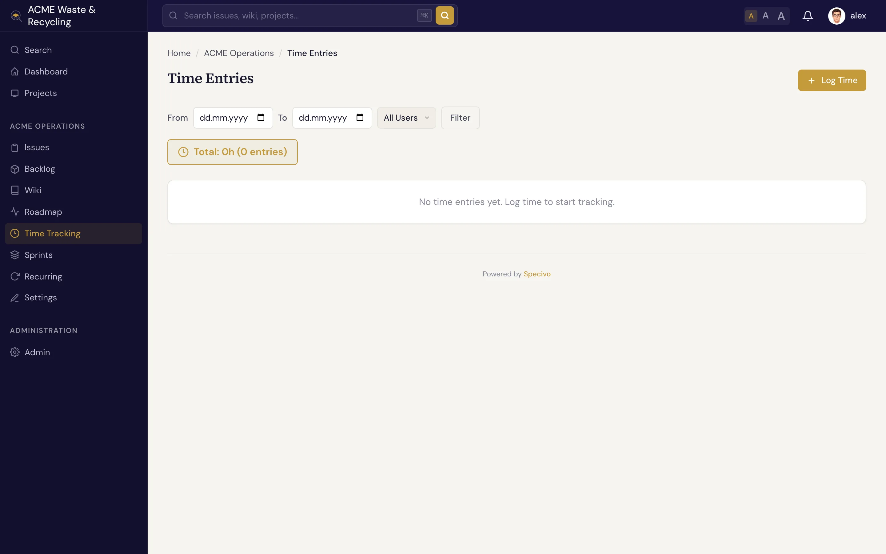

# 工时记录 {#time-tracking}

Specivo 支持为你所做的工作 **记录工时**：在工作项（Issue）或项目上记录花费的小时数，并标注活动类型。记录的工时会汇总到报表中，方便你了解精力都花在哪里，并与预计工时对比。

## 谁能做什么 {#who-can-do-what}

项目中有三项角色权限控制工时记录：

| 权限 | 允许的操作 |
|---|---|
| **查看工时记录** | 查看工时：项目的时间区域、工作项的工时标签页和已记录总计、版本的已记录总计，以及计费工时报表。没有此权限就看不到任何记录，包括自己的。 |
| **记录工时** | 手动或用计时器记录工时，以及编辑、删除自己的记录（前提是你能看到它们）。 |
| **编辑/删除任意工时记录** | 编辑或删除项目中任何人的记录。 |

默认情况下，**Manager**（经理）拥有全部三项权限，**Developer**（开发者）和 **Agent**（代理）可以查看和记录工时，**Reporter**（报告者）和内置的 **Non member**（非成员）角色则没有任何权限。即使没有 *编辑/删除任意工时记录* 权限，只要在项目中拥有 *记录工时* 权限，你仍然可以编辑或删除自己的记录。管理员可以执行所有操作。你无权使用的按钮（*记录工时*、工作项上的记录工时表单、编辑控件）会被隐藏。

项目的 **计费费率** 用于计费工时报表，通过 REST API 管理。创建、修改或删除费率需要 **管理项目设置** 权限，列出费率需要 **查看工时记录** 权限。没有单独的计费权限。

## 为工作项记录工时 {#log-time-against-an-issue}

打开工作项，添加一条工时记录：填写 **小时**、**日期**、**活动**，以及可选的评论。为工作项记录工时是最常见的做法，因为它把投入与具体工作绑定在一起。对于无法归到某一个工作项的工作，也可以在项目层面记录工时。

### 活动 {#activities}

每条记录都标注一个 **活动**，报表就能按类型拆分投入：

| 活动 | 用途 |
|---|---|
| **开发** | 编写和修改代码（默认） |
| **设计** | UI、UX 和设计工作 |
| **测试** | QA、编写测试、验证 |
| **会议** | 计划、站会、评审 |
| **支持** | 帮助用户、响应请求 |

默认选中 **开发**，最常见的情况就少点一次。

## 用计时器计时 {#time-it-with-a-timer}

不用自己累加小时数，交给计时器即可。打开工作项，在工作项编号旁选择 **启动计时器**（需要在项目中拥有 *记录工时* 权限）。同一时间只能有一个计时器：

- 计时器运行期间，每个页面的页头都会显示该工作项编号和已用时间，工作项页面显示 *计时器运行中*。点击页头的计时器可查看该工作项及其主题。
- **停止并记录** 会询问 **活动**（默认活动已预选）和可选的评论，然后在该工作项上写入一条日期为今天的工时记录。已用时间四舍五入到百分之一小时；一直没停的计时器会被截断（上限 12 小时，除非管理员修改过），并在评论中注明。
- **放弃** 直接丢弃计时器，不写入任何内容。

如果你选择 **启动计时器** 时另一个工作项上已有计时器在运行，Specivo 会先询问：**记录并启动** 用默认活动写入其时间，**放弃并启动** 则直接丢弃，随后启动新计时器。如果想用其他活动或附上评论来记录旧计时器，请先从页头停止它。

停止计时器时会再次检查：如果你在此期间失去了在该项目或工作项上记录工时的权限，计时器会被丢弃，不写入任何时间。如果你已无法查看该工作项，页头仍显示其编号，但不显示主题。

AI 智能体（AI agent）可以通过 `specivo_timer` 工具操作同一个计时器（参见[智能体能做什么](../ai-agents/capabilities.md)）。

## 从提交记录工时 {#log-time-from-a-commit}

如果项目配置了[代码仓库集成](../integrations/repositories.md)，并开启了提交命令和工时记录，提交信息也可以记录工时：`ACME-12 @1h30m`（也可写 `@2h`、`@90m` 或 `@1.5h`）会以默认活动，为提交作者在 ACME-12 上记录这段时间，日期为提交当天。作者是指已验证邮箱与提交者邮箱一致的 Specivo 账户，且需要在项目中拥有 *记录工时* 权限。时间必须紧跟在工作项编号之后、同一行内；零会被忽略，一次提交中同一工作项超过 24 小时的会被截为 24 小时。参见[提交命令](../integrations/repositories.md#commit-commands)。

## 预计与已用 {#estimate-versus-spent}

工作项带有 **预计工时**（包含原始预计和剩余预计），以及实际 **已记录** 的工时。两者对比就能看出工作是否在正轨上：一个预计 8 小时、已记录 12 小时却仍未关闭的工作项，值得留意。完整字段见[什么是工作项？](../issues/index.md)。

## 项目的时间区域 {#the-project-time-area}

每个项目都有一个 **时间** 区域，列出工时记录并汇总成报表——按活动、按人员、按日期范围统计——方便 [Manager](index.md) 了解投入在项目中的分布。

!!! note "谁能看到谁的工时"
    默认情况下，拥有 **查看工时记录** 权限的人能看到所有记录。角色若设为 **仅自己的工时记录**（见[角色能看到什么](index.md#what-a-role-can-see)），持有者就只能看到自己记录的工时——在时间区域、工作项、版本总计和报表中都是如此。一个人有多个角色时，取其中范围最宽的设置。

    在你看不到的工作项（例如他人的私有工作项）上记录的工时，会在所有地方被排除：列表、各项总计和计费工时报表，因此数字不会泄露隐藏工作项上的工作。直接记录在项目上、未关联工作项的工时不受影响。你自己的记录始终对你可见，即使是在你已无法查看的工作项上。

