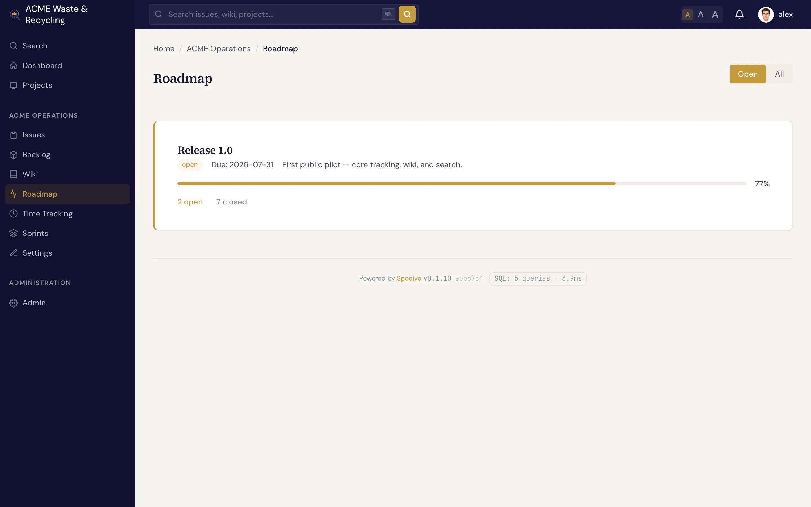
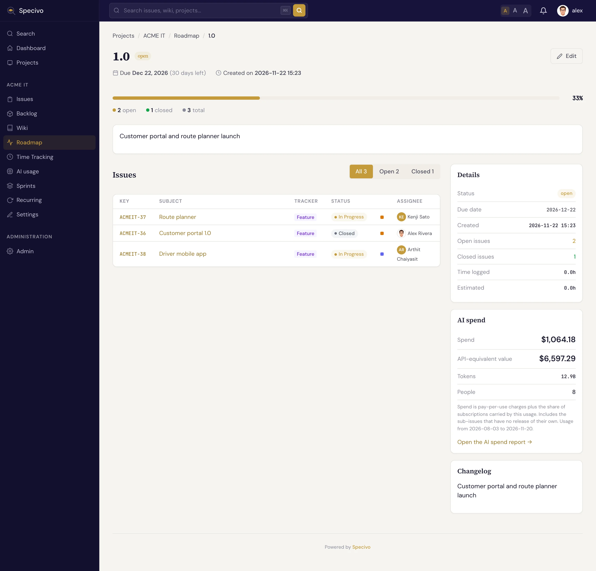

# 版本与路线图 {#versions-roadmap}

**版本** 代表一个里程碑或一次发布，是一个有名称的目标，工作项（Issue）围绕它归组，例如 `v1.2` 或“Q3 发布”。版本用来提前做规划：把工作项指派到某个版本，随着工作推进，**路线图** 上的进度会逐步填满。

## 版本包含的信息 {#what-a-version-holds}

| 字段 | 内容 |
|---|---|
| **名称** | 发布或里程碑的名称，例如 `v1.2` |
| **描述** | 简要说明这个版本的目的 |
| **状态** | **开放**（可继续加入工作）、**已锁定**（不再接收新工作项，进行中的工作继续完成）或 **已关闭**（已发布或已完成） |
| **目标日期** | 计划完成交付的日期 |
| **共享** | 版本共享的范围（例如子项目） |
| **维基页面** | 可选，关联一个[维基页面](../wiki/index.md)（Wiki），适合存放发布说明 |

共享决定版本可以在哪些项目中选用。但它不会把版本展示给无权打开其所属项目的人：如果一个私有项目共享了版本，而你不是该项目的成员，这个版本对你仍然不可见。

可选的 **维基页面** 链接很适合存放发布说明：页面只需写一次，再从版本关联过去，所有查看路线图的人都能找到。

## 把工作项指派到版本 {#assign-an-issue-to-a-version}

打开工作项，把 **目标版本** 字段设为需要的版本。这是工作项与发布之间唯一的关联：设置之后，该工作项会计入这个版本的进度，并在路线图上显示在该版本下。参见[更新工作项](../issues/updating.md)。

只有三种路线图追踪器（Tracker，即工作项类型）的工作项会出现在路线图上：**Bug**（缺陷）、**Feature**（功能）和 **Task**（任务）。**Support**（支持）工作项不会出现，这样日常请求就不会干扰发布规划。

## 路线图 {#the-roadmap}

**路线图** 列出项目的各个版本，并显示每个版本的进度：已完成多少工作项，还有多少未完成。想知道“发布前还剩什么没做”，看一眼路线图就够了。

### 排序与已完成的版本 {#order-and-completed-versions}

默认情况下，路线图只列出仍在推进的版本，即 **开放** 和 **已锁定** 的版本，目标日期最近的排在最前，没有目标日期的排在有日期的之后。**已关闭** 的版本默认隐藏：点击 **显示已完成的版本**，它们会单独列在活跃版本下方；点击 **隐藏已完成的版本** 可再次收起。

使用路线图顶部的排序菜单，可以按以下方式排列版本：

- **截止日期**：最近的在前或最远的在前（没有日期的版本始终排在最后）
- **版本号**：从低到高或从高到低
- **状态**：开放的在前，或已关闭的在前

版本号按人们阅读的习惯排序，而不是逐个字符比较：`0.2.0` 排在 `0.10.0` 之前，`Sprint 9` 排在 `Sprint 10` 之前。名称仍然是自由文本，所以 `Q3 launch` 或 `v1.2-rc1` 这样的名称也可以用。

Specivo 会记住你的选择。同样的排序也用于项目设置中的版本列表，在任意一处修改，两处都会同步变化。这是个人设置，其他人各自保留自己的排序。

路线图、版本页面和项目设置中的进度只统计你有权查看的工作项，所以私有工作项不会计入任何你无法点进去查看的数字。

点击某个版本，可以查看指派给它的工作项（按状态分组），从整体计划直接深入到具体工作。

## 版本的 AI 支出 {#ai-spend-of-a-version}

版本页面上，已记录工时的旁边有一张 **AI 支出** 卡片，显示该版本的支出、API 等价价值、token 数量和人数。统计范围包括该版本下的工作项，以及这些工作项下未单独设置版本的子工作项所产生的 AI 使用，且仅限你有权查看的部分。点击 **打开 AI 支出报告** 会打开项目的[支出报告](ai-spend-reports.md#release-and-sprint)，并限定到该版本，时间范围为该版本 AI 使用所覆盖的日期。

每条记录都计入其工作项当前所属的版本，所以把工作项移到另一个版本时，它的 AI 支出也会随之转移。

## 创建和管理版本 {#creating-and-managing-versions}

版本由项目的 **Manager**（管理者）在项目设置中创建和编辑。设置名称和目标日期；仍在添加工作项时，状态保持 **开放**；临近收尾时改为 **已锁定**；发布完成后将其 **关闭**。

!!! warning "仍在使用的版本无法删除"
    **只要还有工作项引用某个版本，删除就会失败**。Specivo 不会让这些工作项失去归属。请先把所有指向该版本的工作项的 **目标版本** 改为其他版本或清空，然后再删除版本。
