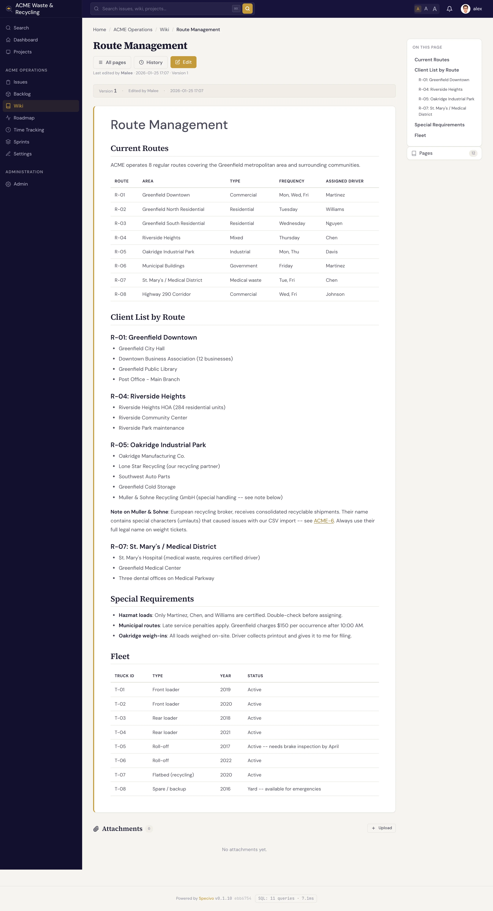
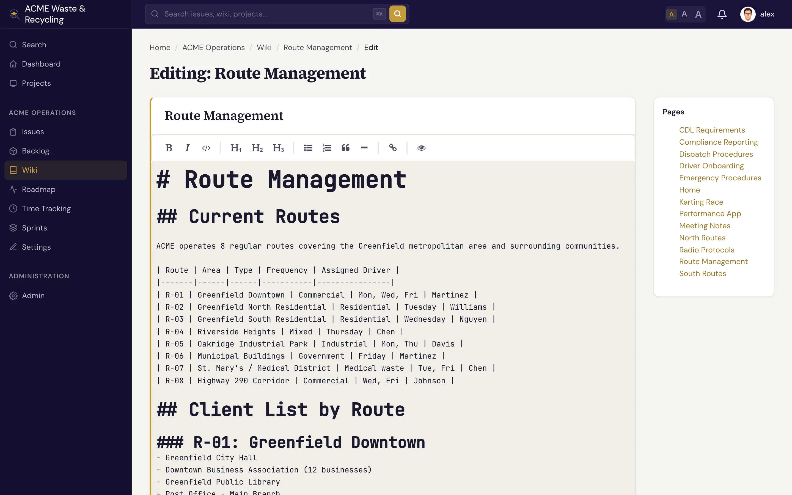

# 创建与编辑页面 {#creating-editing-pages}

在维基（Wiki）里写东西，流程永远是同一套：给页面起个标题，用 Markdown 写内容，保存。每次保存都会生成一个新版本，随时可以回看或回滚，所以放心大胆地编辑，不会有风险。

## 创建页面 {#create-a-page}

1. 打开项目的 **维基** 选项卡。
2. 点击 **新建页面**。
3. 输入 **标题**，单词之间用空格分隔，例如 `Release Process`。Specivo 会自动生成 URL slug。
4. 用 Markdown 编写 **正文**。
5. （可选）选择一个 **父页面** 把它嵌套进去，并填写编辑备注。
6. 点击 **保存**。

最少只需要这两样：一个标题，加一些内容。

!!! tip "标题请用空格"
    输入 `Release Process`，而不是 `Release_Process`。slug（`release-process`）会自动生成，而且 slug 经过了规范化处理，无论大小写和分隔符如何，链接都能正确解析。参见
    [维基概览](index.md#slugs-are-normalized)。

## 编辑页面 {#edit-a-page}

打开任意可编辑的页面，点击 **编辑**。编辑器中会显示页面的 Markdown 源码，改好之后点击 **保存**。

!!! note "受保护的页面只读"
    如果页面被标记为 **受保护**，**编辑** 操作会不可用，直到有人解除其保护状态。参见
    [受保护页面](index.md#protected-pages)。

## 每次保存都是一个新版本 {#every-save-is-a-new-version}

保存时，Specivo 会为页面记录一个 **新版本**，同时记下 **保存人** 和一条 **可选的编辑备注**。备注是一句简短的改动说明（比如“修正了预发布环境的 URL”“补充了回滚步骤”）。值得花几秒写一下，因为日后翻看历史记录时，靠的就是这些备注。

没有任何内容会被原地覆盖：之前的版本都保留着，你可以对比，也可以恢复到任意一版。参见 [历史记录与链接](history-linking.md)。

## 编辑单个章节 {#edit-a-single-section}

要改页面里的某一部分，不必打开整个页面。页面中的每个标题都可以单独编辑。对于很长的页面，只想动其中一节、其余保持不变时，这很方便。章节编辑同样会保存为一个新版本，和整页编辑没有区别。

## 添加附件 {#attach-files}

维基页面支持 **附件**：图表、截图、PDF、导出的数据等。给页面添加文件后，文件会保留原始文件名、大小和类型，还可以填写一段可选的 **描述**。描述内容 **可被搜索**，所以写好描述的附件以后能通过搜索找到。

上传大小上限由运行 Specivo 服务器的管理员设定；文件类型没有内置限制。要在页面正文中显示或链接某个文件，直接写它的文件名即可，例如 `` 或
`[the spec](spec.pdf)`，参见 [按文件名链接附件](../issues/attachments.md#link-to-an-attachment-by-filename)。
附件同样可用于工作项（Issue）和评论，参见 [附件](../issues/attachments.md)。

## 下一步 {#whats-next}

- [历史记录与链接](history-linking.md)：查看历史版本、恢复旧版本、从回收站找回页面，以及用 `[[Page Name]]` 互相链接。
- [Markdown 参考](../reference/markdown.md)：可用的全部排版格式。
- [标签](../projects/tags.md)：给维基页面加上彩色标签，并跨项目按标签筛选。
