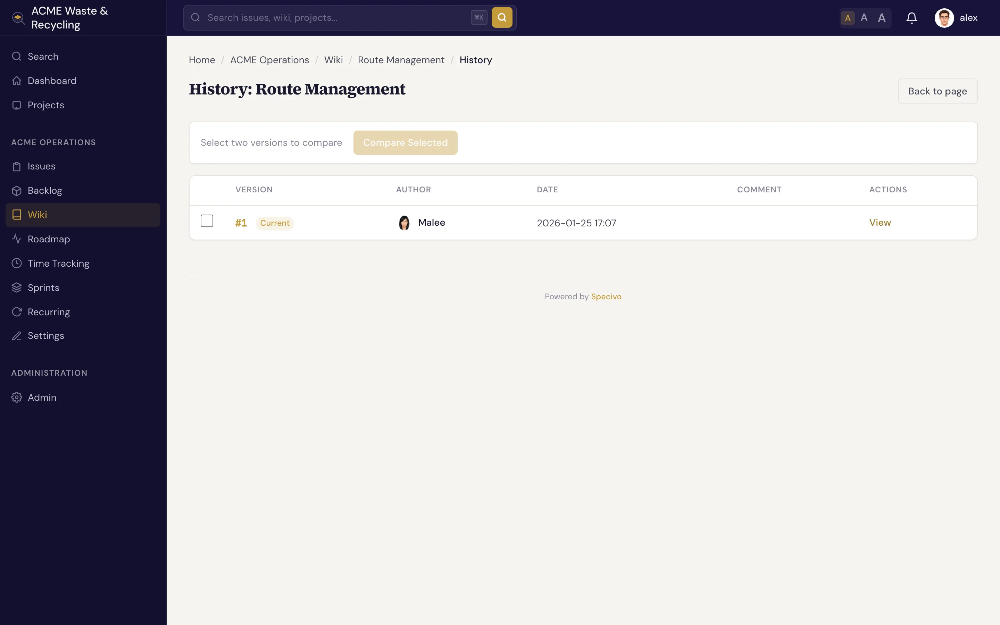

# 历史记录与链接 {#history-linking}

维基会完整记录每个页面的变更过程，并把页面彼此关联起来，也和工作项（Issue）关联起来，让知识保持连通，而不是散落各处。

## 版本历史 {#version-history}

页面每保存一次，Specivo 就会存储一个 **版本**，记录作者和可选的编辑说明。打开页面的 **历史记录**，就能按顺序查看全部版本。



在历史记录中，你可以：

- **查看旧版本**，阅读页面在当时的内容。
- **对比** 两个版本，查看两次保存之间的改动。
- **回退** 到更早的版本，一键完成。回退不会抹掉任何内容，而是新建一个内容与旧版本相同的*新*版本，因此回退这一操作本身也会记录在历史中。

这正是编辑说明重要的原因：一份带日期、带说明的版本列表，能让人一眼看清页面的来龙去脉。参见 [创建与编辑页面](editing.md#every-save-is-a-new-version)。

## 删除与恢复 {#delete-and-restore}

删除维基页面是 **软删除**：页面会移入 **回收站**，而不是被销毁。你可以在回收站中 **恢复** 页面，恢复后历史记录完整保留。

!!! warning "删除是移入回收站，不是彻底消失"
    被删除的页面会从维基和常规导航中消失，所有指向它的 `[[links]]` 都无法再解析，直到页面被恢复。如果误删了，到回收站恢复即可。把删除理解为“隐藏并归档”，而不是必然的永久清除；但删除时仍要慎重，因为在页面恢复之前，读者和链接都会找不到它。

## 页面互链 {#cross-link-pages}

用双方括号把一个维基页面链接到另一个：

```text
See the [[Release Process]] page before you deploy.
```

`[[Page Name]]` 会渲染为指向该页面的链接。由于 slug 经过[规范化](index.md#slugs-are-normalized)处理，不论写成 `[[Release Process]]`、`[[release-process]]` 还是 `[[Release_Process]]`，链接都能解析，并指向同一个页面。可以按页面标题链接，也可以按 slug 链接。

代码中（代码块或 `` `inline code` ``）或原始 HTML 块中的双方括号会原样显示，不会变成链接，也不会计入页面的 **链接来源** 列表或项目链接图。这样你就可以直接说明 `[[...]]` 语法本身，而不会产生死链。

!!! tip "织成一张网，而不是堆成一摞"
    页面互链，才能把一堆页面变成知识库。从概览页链接到细节页，再从细节页链接回概览页，读者（和 AI 智能体（AI agent））就能沿着链接找到内容，而不用到处翻找。

## 维基与工作项如何互联 {#how-wiki-and-issues-connect}

维基页面和工作项属于同一个项目，也会一起出现在 **搜索** 结果中。在任意位置按 <kbd>⌘K</kbd>（<kbd>Ctrl+K</kbd>），Specivo 会同时搜索工作项、维基页面、评论和附件描述，既按关键词，*也*按语义。你写在维基页面上的某个决定，会和促成它的那个工作项一起出现。参见 [查找工作项](../issues/finding.md)。

要把某个工作项和某个页面关联起来，在维基页面上写上工作项编号（`ACME-42`），并在工作项的描述或评论中写上 `[[Page Name]]`。这样，一项工作的两半——工作项里的*做什么*和维基里的*为什么*——只隔一次点击，而且两边会互相列出对方：

- 工作项的 **关联** 标签页中有 **提及于** 区域，列出提及该工作项的维基页面、工作项和评论（参见 [关联](../issues/relations.md#mentioned-in)）；
- 维基页面底部有 **链接来源** 区域，打开即可看到链接到该页面的页面、工作项和评论。

要链接到 **其他项目** 的维基页面，用普通 Markdown 链接指向该页面的地址即可，例如 `[Runbook](/projects/OPS/wiki/runbook/)`；写成你的 Specivo 的完整 `https://` 地址也可以。链接到工作项（`/issue/ACME-42/`）和附件的方式相同。

这两个列表只显示你自己有权打开的内容：私有工作项、私有备注，或你无权阅读的维基中的页面会直接省略，而不会以隐藏标题的形式出现。AI 智能体在 `specivo_show_issue` 和 `specivo_read_wiki` 中看到同样的链接，还可以用 `specivo_get_links` 进一步追踪（参见 [智能体能做什么](../ai-agents/capabilities.md)）。

## 项目链接图 {#the-project-link-graph}

Specivo 会记录项目的维基页面、工作项描述和评论中写下的每一个链接，并在每次保存后的几秒内更新。项目管理者可以在 **项目设置 → 搜索** 的 **链接图** 卡片中查看：

- 链接总数，按类型（维基链接、工作项提及、附件链接）和写入位置分类统计，并与项目的关联、父级链接和附件数量并列显示；
- 有多少链接指向尚不存在的目标，以及其中最常见的几个（拼错的 `[[page]]`，或从未创建过的工作项编号），仅统计你有权阅读的文本；
- 链接图最近一次变更的时间，以及最近一次完整重建的结果。

**重建链接图** 会重新读取项目中的所有文本，把能链接的都链接起来。一般很少需要：导入操作会自行重建链接图。以下情况可以使用：从 Specivo 之外大量导入数据之后、升级改变了链接判定规则之后，或链接看起来已经过时时。重建在后台运行并显示进度计数，每个项目同一时间只运行一个。在命令行中，`make rebuild-links`（或 `make rebuild-links PROJECT=ACME`）效果相同。

## 下一步 {#whats-next}

- [维基概览](index.md)：页面、slug、嵌套和受保护页面。
- [创建与编辑页面](editing.md)：撰写、编辑和附加文件。
