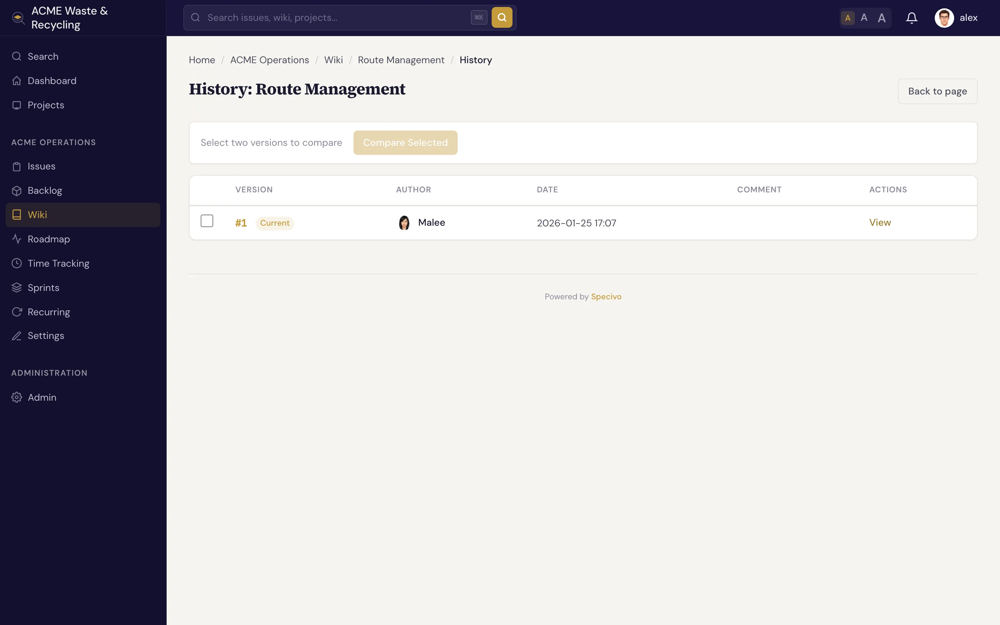

# 历史记录与页面链接 {#history-linking}

维基（Wiki）会完整记录每个页面的所有变更，并把页面彼此关联起来，也和工作项（Issue）关联起来，让知识保持连通，而不是四处散落。

## 版本历史 {#version-history}

每次保存页面，Specivo 都会存储一个 **版本**，记录作者和可选的编辑说明。打开页面的 **历史记录**，就能按顺序查看全部版本。



在历史记录中，你可以：

- **查看历史版本**，阅读页面在当时的内容。
- **比较** 两个版本，看看两次保存之间改了什么。
- **回退** 到更早的版本，只需一键。回退不会抹掉任何内容：它会创建一个 *新* 版本，其内容与旧版本一致，因此回退操作本身也会记入历史。

这正是编辑说明重要的原因：一份带日期、带说明的版本列表，让人一眼就能看出页面的演变过程。参见 [创建与编辑页面](editing.md#every-save-is-a-new-version)。

## 删除与恢复 {#delete-and-restore}

删除维基页面是 **软删除**：页面会移入 **回收站**，而不是被销毁。你可以从回收站 **恢复** 页面，其历史记录也会完整保留。

!!! warning "删除只是移入回收站，不会彻底消失"
    被删除的页面会从维基和常规导航中消失，指向它的所有 `[[links]]` 在恢复之前都无法解析。如果误删，请从回收站恢复。把删除理解为“隐藏并归档”，而不是保证永久清除；但仍要慎重删除，因为在此期间读者和链接都会找不到该页面。

## 页面互链 {#cross-link-pages}

用双方括号把一个维基页面链接到另一个页面：

```text
See the [[Release Process]] page before you deploy.
```

`[[Page Name]]` 会渲染为指向该页面的链接。由于 slug 会被[规范化](index.md#slugs-are-normalized)，无论你写 `[[Release Process]]`、`[[release-process]]` 还是 `[[Release_Process]]`，链接都能解析，它们指向同一个页面。既可以按页面标题链接，也可以按 slug 链接。

代码中（代码块或 `` `inline code` ``）以及原始 HTML 块中的双方括号会原样显示，不会变成链接，也不会计入页面的反向链接或失效链接列表。这样你就能在文档中说明 `[[...]]` 语法本身，而不会产生死链。

!!! tip "织成一张网，而不是堆成一堆"
    正是页面互链让一堆页面变成知识库。从概览页面向下链接到细节页面，再从细节页面链接回上层，读者和 AI 智能体（AI agent）就能顺着线索走，而不必四处翻找。

## 维基与工作项如何关联 {#how-wiki-and-issues-connect}

维基页面和工作项属于同一个项目，也会一起出现在 **搜索** 结果中。在任何位置按 <kbd>⌘K</kbd>（<kbd>Ctrl+K</kbd>），Specivo 会同时搜索工作项、维基页面、评论和附件描述，既按关键词匹配，*也* 按语义匹配。你写在维基页面上的某个决定，会和促成它的那个工作项一起出现。参见 [查找工作项](../issues/finding.md)。

要把某个工作项和某个页面绑在一起，可以在维基页面中链接该工作项（粘贴它的 URL），再在工作项的描述或评论中引用该页面。这样，一项工作的两半——工作项里的“做什么”和维基里的“为什么”——始终只隔一次点击。

## 下一步 {#whats-next}

- [维基概览](index.md)：页面、slug、嵌套和受保护页面。
- [创建与编辑页面](editing.md)：撰写、编辑和附加文件。
