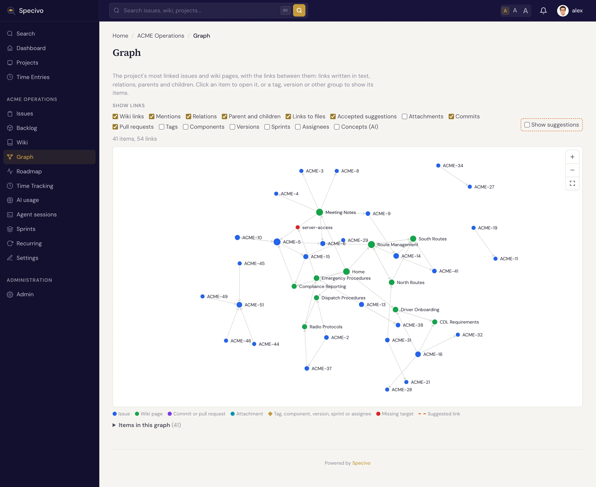
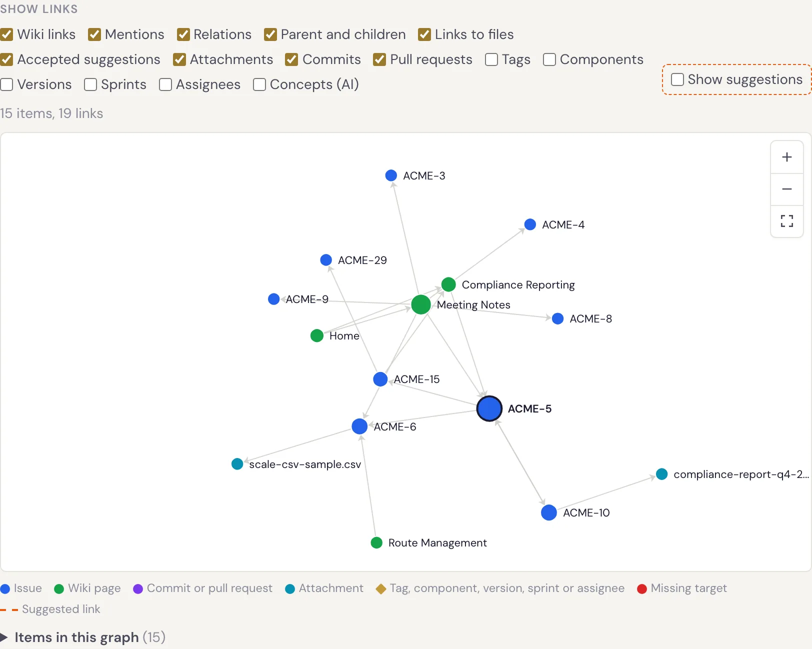
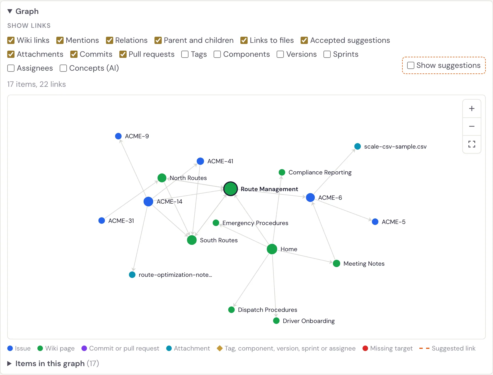

# 历史记录与链接 {#history-linking}

维基（Wiki）完整记录每个页面的变更过程，并把页面与页面、页面与工作项（Issue）关联起来，让知识彼此相连，而不是散落各处。

## 版本历史 {#version-history}

每次保存页面，Specivo 都会存下一个 **版本**，并记录作者和可选的编辑备注。打开页面的 **历史记录**，可以按顺序查看全部版本。


在历史记录中，你可以：

- **查看历史版本**：阅读页面在当时的内容。
- **比较** 版本：查看两次保存之间改了什么。
- 一键 **回退** 到较早的版本。回退不会抹掉任何内容，而是创建一个内容与旧版本相同的*新*版本，所以回退操作本身也会记入历史。

编辑备注的意义就在这里：一份带日期、带备注的版本列表，能让人一眼看清页面的来龙去脉。参见[创建与编辑页面](editing.md#every-save-is-a-new-version)。

## 删除与恢复 {#delete-and-restore}

删除维基页面是 **软删除**：页面不会被销毁，而是移入维基的 **回收站**，之后可以从那里 **恢复**，历史记录完好无损。删除和恢复都需要 **删除维基页面** 权限（参见[角色](../install/roles.md)）；没有这项权限，页面上不会显示 **删除** 按钮，维基里也不会显示 **回收站** 链接。

要删除页面，打开该页面，点击 **删除** 并确认。之后会跳转到全部页面的列表。首页没有 **删除** 按钮：每个维基都必须保留一个首页。

如果页面有子页面，对话框会询问如何处理它们：

- 不勾选 **同时将其子页面移入回收站**，则只删除该页面。它的直接子页面上移一级，挂到被删页面的父页面之下（或成为顶级页面），仍留在维基中。
- 勾选后，整个分支随该页面一起移入回收站。

要恢复页面，打开 **回收站**（入口在全部页面的列表中，或任意页面上 **页面** 面板的底部），点击该页面旁边的 **恢复**。与它一同删除的子页面也会一并恢复，回到原来的位置。如果在此期间已有其他页面占用了被删页面的地址（即它的 slug），恢复会被拒绝：请先重命名或删除那个页面。

页面在回收站中保留 **90 天**。到期后，后台 worker 会将其永久删除（每天执行一次）：页面连同全部历史、评论、标签和附件（包括文件本身）一并清除，此后无法再恢复。较晚移入回收站的子页面，会保留到它自己的 90 天期满为止。管理员可通过 `WIKI_TRASH_RETENTION_DAYS` 设置保留期限（参见[配置](../install/configuration.md)）；设为 `0` 表示回收站永久保留。

!!! warning "删除会先把页面移入回收站，之后才彻底清除"
    被删除的页面会从维基和常规导航中消失，所有指向它的 `[[links]]` 在页面恢复之前都无法解析。如果是误删，请在保留期限结束前从回收站恢复。在此之前，页面及其文件仍然保存在存储中，所以删除也并不等于立即抹除数据。

## 页面间互相链接 {#cross-link-pages}

用双方括号把一个维基页面链接到另一个页面：

```text
See the [[Release Process]] page before you deploy.
```

`[[Page Name]]` 会渲染为指向该页面的链接。由于 slug 会被[规范化](index.md#slugs-are-normalized)，无论写成 `[[Release Process]]`、`[[release-process]]` 还是 `[[Release_Process]]`，链接都能解析，指向的是同一个页面。你可以用页面标题来链接，也可以用 slug。

代码（代码块或 `` `inline code` ``）和原始 HTML 块中的双方括号会按原样显示，不会变成链接，也不会计入页面的 **链接来源** 列表或项目的链接图。这样你就可以在文档里讲解 `[[...]]` 语法本身，而不会产生失效链接。

!!! tip "织一张网，而不是堆一摞纸"
    有了交叉链接，一个装满页面的文件夹才成为知识库。从概览页向下链接到细节，再从细节页链接回去，读者（以及 AI 智能体）就能顺着线索找到内容，不必四处翻找。

## 维基与工作项如何关联 {#how-wiki-and-issues-connect}

维基页面和工作项同属一个项目，在 **搜索** 中会一起出现。在任意位置按下 <kbd>⌘K</kbd>（<kbd>Ctrl+K</kbd>），Specivo 会同时搜索工作项、维基页面、评论和附件描述，既按关键词匹配，*也*按语义匹配。你写在维基页面上的某项决策，会和引出这项决策的工作项一同出现在结果里。参见[查找工作项](../issues/finding.md)。

要把某个工作项和某个页面关联起来，在维基页面上写下工作项编号（`ACME-42`），并在工作项的描述或评论中写上 `[[Page Name]]`。这样，一项工作的两面（工作项里的“做什么”和维基里的“为什么”）只隔一次点击，而且双方都会列出对方：

- 工作项的 **关联** 标签页中有 **提及于** 区域，列出提到它的维基页面、工作项和评论（参见[关联](../issues/relations.md#mentioned-in)）；
- 维基页面底部有 **链接来源** 区域。展开它，可以看到链接到该页面的页面、工作项和评论。

要链接到 **其他项目** 的维基页面，使用指向该页面地址的普通 Markdown 链接，例如 `[Runbook](/projects/OPS/wiki/runbook/)`；指向你自己 Specivo 实例的完整 `https://` 地址同样有效。指向工作项（`/issue/ACME-42/`）和附件的链接也是同样的写法。

这两个列表只显示你自己有权打开的内容：私有工作项、私有备注，或者你无权阅读的维基中的页面，都会被直接略去，不会以隐藏标题的形式出现。AI 智能体（AI agent）在 `specivo_show_issue` 和 `specivo_read_wiki` 中看到的是同样的链接，还可以用 `specivo_get_links` 沿着链接继续追踪（参见[智能体能做什么](../ai-agents/capabilities.md)）。

## 项目链接图 {#the-project-link-graph}

Specivo 会记录项目的维基页面、工作项描述和评论中写下的每一个链接，并在每次保存后的几秒内更新。项目管理者可以在 **项目设置 → 搜索** 的 **链接图** 卡片中看到：

- 链接的数量，按种类（维基链接、工作项提及、附件链接）和书写位置分别统计，旁边还列出项目的关联、父子链接和附件数量；
- 有多少链接指向尚不存在的目标，并列出其中最常见的几个（拼错的 `[[page]]`，或者从未创建过的工作项编号），统计范围仅限你有权阅读的文本；
- 链接图上次变更的时间，以及上一次完整重建的结果；
- **上次重建：** 显示上一次完整重建的日期和时间（按你的时区）。从未重建过的项目显示 **尚未索引 — 重建已排队**。

链接图从未完整构建过的项目会自动重建。一个每小时运行一次的后台任务会为每个这样的项目排入一次重建（每次最多 50 个项目；已有重建在排队或运行时不会重复排入），卡片上会把它显示为一次正常运行中的重建，发起者为 **自动回填**。即使部分文本处理失败，这次重建也算完成，所以某段文本反复失败并不会导致每小时都发起新的重建；失败情况会显示在上一次的结果中。这项功能要求后台 worker 和调度器处于运行状态。

**重建链接图** 会重新读取项目的全部文本，并把能链接的内容都链接起来。你很少需要用到它：导入时会自行重建链接图。以下情况可以使用：从 Specivo 之外导入了大量数据之后；升级改变了链接的判定规则之后；或者链接看起来已经过时。重建在后台运行并显示进度计数，每个项目同一时间只运行一个重建。在命令行中执行 `make rebuild-links`（或 `make rebuild-links PROJECT=ACME`）效果相同。

标签、版本、冲刺（Sprint）、负责人以及部分元数据键的值也是链接图的一部分，供 AI 智能体使用：参见[在链接图中导航](../ai-agents/capabilities.md#navigating-the-link-graph)。

## 查看关系图 {#seeing-the-graph}

这些链接也可以用图形的方式查看：

- 工作项有 **关系图** 标签页，位于 **关联** 旁边；
- 维基页面底部有 **关系图** 区域，位于 **链接来源** 下方；
- 项目菜单中有 **关系图** 页面，展示项目中链接最多的工作项和维基页面，以及它们之间的链接。

在工作项或页面上，关系图显示当前条目（画得更大）、它链接到的内容和链接到它的内容，并再向外延伸一步。工作项、维基页面、提交和拉取请求、附件以及不存在的目标（不存在的 `[[page]]` 或工作项编号）各有自己的颜色，图下方的图例会逐一说明。在 **显示链接** 下，可以勾选或取消各类链接：维基链接、提及、关联、父子关系、文件链接、附件、提交和拉取请求默认显示。勾选 **标签**、**组件**、**版本**、**冲刺** 或 **负责人** 后，它们会以小菱形的形式加入图中，并标出各自包含的条目数。**概念（AI）** 默认也是关闭的：它会加入项目的 AI 提供商从工作项和页面中识别出的概念（参见[概念提取](../projects/index.md#concept-extraction-ai)），该功能未开启时为空。**已接受的建议** 是由[建议](#possibly-related-suggested-links)生成的类型化链接。

点击工作项、页面、提交或拉取请求可以打开它。点击菱形（标签、版本等）可以把其中的条目加入图中。在图上任意位置拖动可以移动画面，滚动或双指捏合可以缩放，也可以使用图上方的 **放大**、**缩小** 和 **重置视图** 按钮。把鼠标悬停在条目或连线上，可以看到它是什么。图下方的 **此图中的条目** 以链接的形式列出同样的条目，方便键盘操作和屏幕阅读器使用，每个标签、版本等旁边都有 **显示其中的条目** 按钮。







和上面的列表一样，关系图只显示你自己有权打开的内容。为了让链接密集的项目依然清晰可读，关系图设有上限：一次读取最多返回 1,000 个链接（距离最近的优先），而你展开的所有菱形加在一起，图中最多容纳 1,500 个链接。服务器省略了部分内容时，图上方的一行文字会给出提示；图已满时，这行文字显示“关系图已满：打开某个条目，从那里继续探索。”超过 150 个条目或 600 个链接的关系图会一次性完成布局，而不是通过动画逐渐稳定下来。当你的 Specivo 开始为相似的工作项和页面建议链接后，**显示建议** 会把建议的链接加入图中，以虚线表示。查看关系图需要登录。

## 可能相关：建议的链接 {#possibly-related-suggested-links}

开启语义搜索（已安装内置的嵌入模型）后，Specivo 还会建议没有人写过的链接：同一项目中内容相近、且尚未以任何方式关联的工作项和维基页面。它们只是提示，不是链接。可以在两个地方找到：

- 在工作项上，位于 **关联** 标签页的 **可能相关** 下；
- 在维基页面上，位于底部的 **可能相关** 区域（展开后加载列表）。

建议分为 **工作项** 和 **维基页面** 两组，每组标有数量。每一行都标明类型（蓝色的*工作项*或绿色的*维基页面*标签和边线），并显示对方条目、其文本的开头几行（工作项描述或页面内容），以及一个 0 到 1 之间的分数，表示两段文本的接近程度。每组最多列出 10 条，按相似度从高到低排列，且只包含你自己有权打开的条目；组下方的说明会告诉你还有多少相似度较低的条目没有显示。每个条目最多建议 10 个工作项和 10 个页面。

在向量嵌入看来，同一项目的大多数条目本来就彼此相似：它们共用项目的词汇，文本类型也相同，所以即使两个毫不相关的条目也会得到很高的分数。因此，只有当两个条目之间的接近程度明显高于同一项目中两个普通条目时，才会给出建议。Specivo 的判断方法是：先去掉项目所有条目的共同部分，再比较这两个条目。显示的分数仍然是未经处理的原始分数。如果项目中文本已生成向量嵌入的工作项和页面不足 10 个，就不会有任何建议，因为条目太少，无法判断什么才算“普通”。

如果你有权关联这两个条目，每条建议都会带有 **链接为** 选项和两个按钮：

- **接受** 把建议变成真正的链接。两个工作项之间会建立普通的关联（选择类型：**关联到**、**阻塞**、**重复于**……），这需要管理工作项关联的权限。一个工作项和一个页面之间，或两个页面之间，会建立一条从当前条目指向对方的*类型化链接*：**另请参阅**、**记录**、**实现**、**决定于** 或 **取代**。这需要编辑该工作项的权限；如果当前条目是页面，则需要管理维基的权限。类型化链接和手写链接一样会被列出（在 **提及于** 和 **链接来源** 中），并带有类型；由于它不写在文本里，编辑文本时不会丢失。
- **关闭** 会永久隐藏这条建议，之后不会再次建议。它需要同样的权限。

工作项或页面保存后（文本完成向量嵌入时）会重新计算建议，此外每晚还会为所有项目重新计算一次。已经关联的条目对（手写链接、类型化链接、关联、父子关系）永远不会被建议。

两个条目必须比普通水平接近多少才会被建议，项目管理者可以通过 REST API（`PATCH /api/v1/projects/<KEY>/`）修改项目设置 `similar_links_threshold` 来调整。取值范围为 0 到 0.95，默认为 0.30；值越高，建议越少、相关性越强。这个值是在去掉共同部分之后衡量的，所以不能与每行显示的分数直接比较。新值会在下一次计算时生效。如果不想等到夜间，想立即计算建议，管理员可以在 API 容器中运行 `python -m specivo.cli.similar_links`（或加上 `--project ACME`）。如果升级改变了建议的选取方式，夜间计算会把所有项目更新到最新状态，你也可以运行该命令立即完成更新。

## 接下来 {#whats-next}

- [维基概览](index.md)：页面、slug、层级嵌套和受保护页面。
- [创建与编辑页面](editing.md)：撰写、编辑和上传附件。
