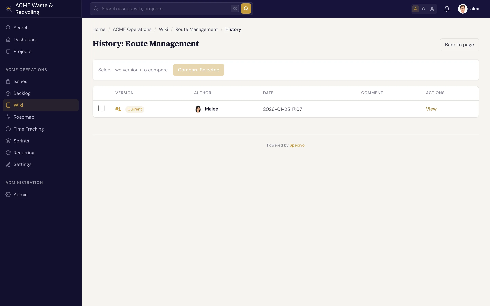

# 历史记录与链接 {#history-linking}

维基（Wiki）完整记录每个页面的变更过程，并把页面与页面、页面与工作项（Issue）关联起来，让知识彼此连通，而不是散落各处。

## 版本历史 {#version-history}

每次保存页面，Specivo 都会存下一个 **版本**，并记录作者和可选的编辑备注。打开页面的 **历史记录**，可以按顺序查看全部版本。



在历史记录中，你可以：

- **查看历史版本**：阅读页面在当时的内容。
- **比较** 版本：查看两次保存之间改了什么。
- 一键 **回退** 到较早的版本。回退不会抹掉任何内容，而是创建一个内容与旧版本相同的*新*版本，所以回退操作本身也会记入历史。

编辑备注的意义就在这里：一列带日期、带备注的版本，让人一眼看清页面的来龙去脉。参见[创建与编辑页面](editing.md#every-save-is-a-new-version)。

## 删除与恢复 {#delete-and-restore}

删除维基页面是 **软删除**：页面不会被销毁，而是移入维基的 **回收站**，你可以从那里 **恢复** 它，历史记录完好无损。删除和恢复都需要 **删除维基页面** 权限（参见[角色](../install/roles.md)）；没有该权限时，页面上不显示 **删除** 按钮，维基中也不显示 **回收站** 链接。

要删除页面，打开该页面，点击 **删除** 并确认。之后会跳转到全部页面列表。首页没有 **删除** 按钮：每个维基都必须保留一个首页。

如果页面有子页面，对话框会询问如何处理它们：

- 不勾选 **同时将其子页面移至回收站**，则只删除该页面。它的直接子页面上移一级，归到被删页面的父页面之下（或成为顶级页面），仍留在维基中。
- 勾选后，整个分支随该页面一起移入回收站。

要恢复页面，打开 **回收站**（入口在全部页面列表中，或任意页面的 **页面** 面板底部），点击该页面旁边的 **恢复**。与它一起删除的子页面也会一并恢复，回到原来的位置。如果在此期间另一个页面占用了被删页面的地址（即它的 slug），恢复会被拒绝：请先重命名或删除那个页面。

!!! warning "删除是移入回收站，不是彻底抹除"
    被删除的页面会从维基和常规导航中消失，指向它的 `[[links]]` 在页面恢复之前都无法解析。如果是误删，从回收站恢复即可。请把删除理解为“隐藏并归档”，而不是保证永久清除；但删除前仍要慎重，因为在此期间读者看不到这个页面，链接也会失效。

## 交叉链接页面 {#cross-link-pages}

用双方括号从一个维基页面链接到另一个页面：

```text
See the [[Release Process]] page before you deploy.
```

`[[Page Name]]` 会渲染为指向该页面的链接。slug 会[规范化](index.md#slugs-are-normalized)，所以无论写成 `[[Release Process]]`、`[[release-process]]` 还是 `[[Release_Process]]`，链接都能解析，指向同一个页面。你可以用页面标题来链接，也可以用 slug。

代码（代码块或 `` `inline code` ``）和原始 HTML 块中的双方括号会原样显示，不会变成链接，也不计入页面的 **链接来源** 列表和项目的链接图。这样你就可以在文档中介绍 `[[...]]` 语法本身，而不会产生死链接。

!!! tip "织成一张网，别堆成一堆"
    有了交叉链接，一堆页面才成为知识库。从概览页面向下链接到细节页面，再从细节页面向上链接回来，读者（以及 AI 智能体）就能顺着线索找到内容，不必到处翻找。

## 维基与工作项如何关联 {#how-wiki-and-issues-connect}

维基页面和工作项同属一个项目，也会一起出现在 **搜索** 结果中。在任意位置按 <kbd>⌘K</kbd>（<kbd>Ctrl+K</kbd>），Specivo 会同时搜索工作项、维基页面、评论和附件描述，既按关键词搜索，*也*按语义搜索。你写在维基页面上的某项决策，会和促成这项决策的工作项一起出现。参见[查找工作项](../issues/finding.md)。

要把某个工作项和某个页面关联起来，在维基页面中写上工作项编号（`ACME-42`），并在工作项的描述或评论中写上 `[[Page Name]]`。这样，一项工作的两个部分（工作项里的*做什么*和维基里的*为什么*）只隔一次点击，而且两边都会列出对方：

- 工作项的 **关联** 标签页有一个 **提及于** 区域，列出提及它的维基页面、工作项和评论（参见[关联](../issues/relations.md#mentioned-in)）；
- 维基页面底部有一个 **链接来源** 区域。展开它，可以看到链接到该页面的页面、工作项和评论。

要链接到 **其他项目** 维基中的页面，使用普通的 Markdown 链接并指向该页面的地址，例如 `[Runbook](/projects/OPS/wiki/runbook/)`；指向你的 Specivo 的完整 `https://` 地址同样有效。指向工作项（`/issue/ACME-42/`）和附件的链接也是同样的写法。

这两个列表只显示你自己能打开的内容：私有工作项、私有备注，或者你无权阅读的维基中的页面，都会被直接略去，不会以隐藏标题的形式出现。AI 智能体（AI agent）在 `specivo_show_issue` 和 `specivo_read_wiki` 中看到的是同样的链接，还可以用 `specivo_get_links` 继续追踪（参见[智能体能做什么](../ai-agents/capabilities.md)）。

## 项目链接图 {#the-project-link-graph}

Specivo 会记录项目的维基页面、工作项描述和评论中写下的每一个链接，并在每次保存后几秒内更新。项目管理者可以在 **项目设置 → 搜索** 的 **链接图** 卡片中查看：

- 链接数量，按类型（维基链接、工作项提及、附件链接）和书写位置分别统计，旁边还列出项目的关联、父级链接和附件数量；
- 有多少链接指向尚不存在的目标，并列出其中最常见的几个（拼错的 `[[page]]`，或从未创建过的工作项编号），仅统计你有权阅读的文本；
- 链接图上次变更的时间，以及上次完整重建的结果；
- **上次重建：** 后面显示上次完整重建的日期和时间，按你的时区显示。从未重建过的项目显示 **尚未索引 — 重建已排队**。

链接图从未完整构建过的项目会自动重建。一个每小时运行一次的后台任务会为每个这样的项目排入一次重建（每次运行最多 50 个项目；已有重建在排队或运行时不会重复排入），卡片上将其显示为一次正常运行中的重建，发起者为 **自动回填**。即使部分文本处理失败，重建也算完成，因此一段持续失败的文本不会每小时触发一次新的重建；失败情况会显示在上次结果中。此功能需要后台 worker 和调度器处于运行状态。

**重建链接图** 会重新读取项目的全部文本，并为所有可以链接的内容建立链接。你很少需要用到它：导入时会自行重建链接图。适用的场景有：从 Specivo 外部大量导入数据之后、升级改变了链接的判定规则之后，或者链接看起来已经过时。重建在后台运行并显示进度计数，每个项目同一时间只运行一个重建。在命令行中，`make rebuild-links`（或 `make rebuild-links PROJECT=ACME`）效果相同。

标签、版本、冲刺（Sprint）、负责人以及部分元数据键的值也是链接图的一部分，供 AI 智能体使用：参见[浏览链接图](../ai-agents/capabilities.md#navigating-the-link-graph)。

## 接下来 {#whats-next}

- [维基概览](index.md)：页面、slug、层级嵌套和受保护页面。
- [创建与编辑页面](editing.md)：撰写、编辑和附加文件。
