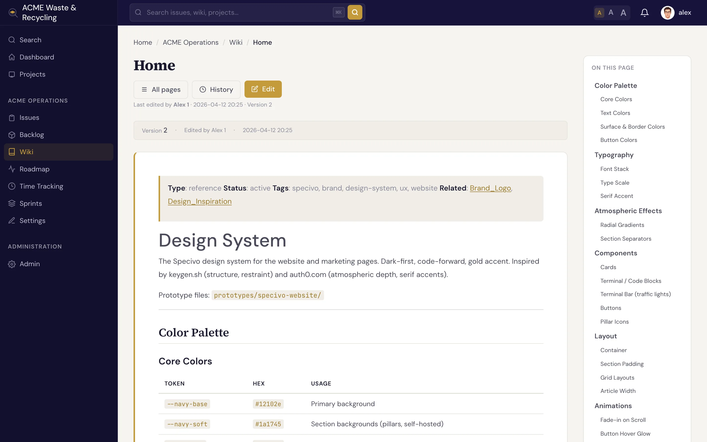

# 维基概览 {#wiki-overview}

在 Specivo 中，每个项目都有自己的 **维基**（Wiki），用来存放那些不适合放进工作项（Issue）的内容：设计笔记、运维手册、新人入职文档、会议决议、团队约定。页面用 Markdown 编写，可以互相链接，并完整保留编辑历史，内容不会丢失。

**一个项目对应一个维基**。在项目的 **维基** 标签页中打开它。

## 什么是维基页面 {#what-a-wiki-page-is}

维基页面由 **标题** 和 Markdown 格式的 **正文** 组成。标题是读者看到的页面大标题，也是链接中显示的名称；Specivo 会根据标题自动生成 URL **标识串**（slug）。你只需写标题，标识串由 Specivo 处理。

| 组成部分 | 说明 |
|---|---|
| 标题 | 便于阅读的页面名称，显示为页面大标题 |
| 标识串 | 适用于 URL 的标识符，由标题派生 |
| 正文 | Markdown 内容：各级标题、列表、表格、代码、图片、链接 |

页面支持与工作项描述、评论相同的 Markdown 语法，另外还支持维基专用的交叉链接 `[[Page Name]]`。交叉链接详见[历史记录与链接](history-linking.md)，完整语法见 [Markdown 参考](../reference/markdown.md)。

## 标识串会自动规范化 {#slugs-are-normalized}

你不必记住页面名称的大小写和分隔方式。标识串经过 **规范化** 处理，以下写法都会指向同一个页面：

- `My Page`
- `my-page`
- `My_Page`

因此，无论是链接、搜索结果还是手动输入的 URL，即使大小写或分隔符不同，也都能到达正确的页面。

如果标题中没有任何拉丁字母或数字（例如纯泰文标题 `คู่มือเริ่มต้น`），Specivo 也会为它生成一个可用且唯一的地址（`page-<id>`），而不是空的标识串。这样非拉丁文字的页面同样可以正常链接和访问。

!!! tip "标题用空格，不要用下划线"
    创建页面时，标题中的单词用 **空格** 分隔：写 `Release Process`，不要写 `Release_Process`。
    Specivo 会自动生成干净的标识串（`release-process`）。标题里的下划线只会让页面大标题显得别扭。

## 嵌套页面 {#nested-pages}

页面可以有 **父页面**，因此你可以构建层级结构，而不只是一个平铺的列表。例如顶层页面 `Onboarding`，下面放 `Onboarding / Dev Setup` 和 `Onboarding / Accounts`。嵌套只是用于组织：让相关页面归在一起，更容易浏览。

## 受保护页面 {#protected-pages}

页面可以标记为 **受保护**，标记后即为 **只读**。适合存放应保持稳定、不宜随意修改的内容，例如已发布的制度、定稿的规格说明或参考资料。读者仍然可以打开和链接受保护页面；受保护状态只决定它能否被编辑。

## 下一步 {#whats-next}

- [创建与编辑页面](editing.md)：撰写页面、编辑内容、添加附件，以及按章节编辑。
- [历史记录与链接](history-linking.md)：版本历史、回退、回收站，以及 `[[cross-links]]` 交叉链接。
